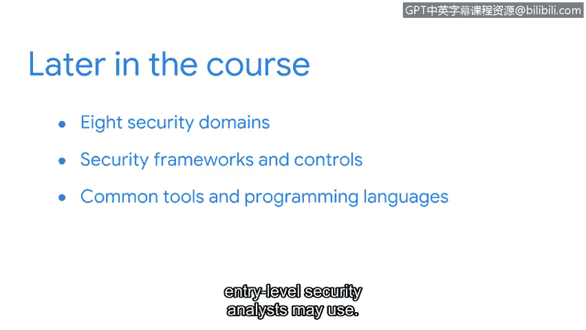

# 谷歌网络安全专业证书第一课：《信息安全基础》（中英字幕，前面分p中字，后面分p英字） - P31：1_04_welcome-to-week-1.en_subtitled - GPT中英字幕课程资源 - BV1Bk4y1u7KL

Hi again。Now that you have some idea of what to expect from the program as a whole。

 let's discuss more about what you'll learn in this course。

This course will introduce you to the world of security and how it's used to protect business operations。

 users and devices so you can contribute to the creation of a safer internet for all。In this section。

 we'll cover foundational security concepts。 First， we'll define security。

Then we'll explore common job responsibilities of security analysts。

Building on that will cover core skills a security analyst may have。Finally。

 we'll discuss the value of security for protecting organizations and people Later on。

 we'll cover eight security domains。Then we'll cover common security frameworks and controls。Finally。

 we'll wrap up the course by discussing common tools and programming languages that entry level of security analysts may use。

Coming up， we'll go over some resources that will allow you to get the most out of this program。

I'm really excited for you to start this journey。 Let's begin。😊。

