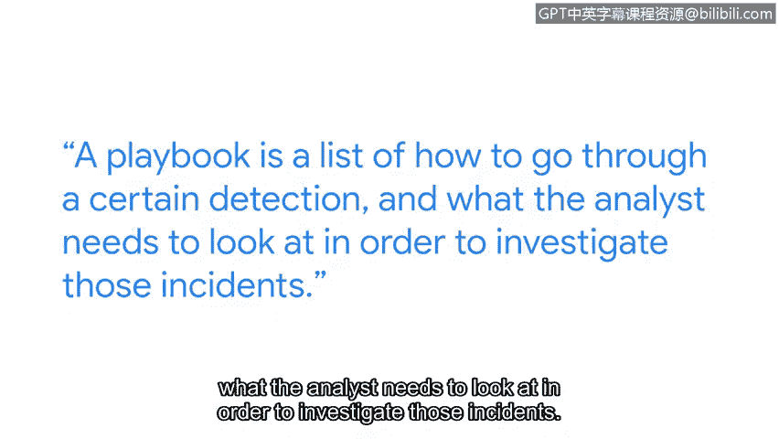

# 谷歌网络安全专业证书第一课：《信息安全基础》（中英字幕，前面分p中字，后面分p英字） - P35：5_04_nikki-a-day-in-the-life-of-a-security-engineer.en_subtitled - GPT中英字幕课程资源 - BV1Bk4y1u7KL

My name is Nikki and I'm a security engineer at Google。

I am part of the Inr threat detection team at Google。

 so my role is more focused on catching insider threats or insider suspicious activity within the company。

 My first experience with cybersecurity was when I was interning at the aquarium I learned a lot of network security there they had a lot of phishing attempts of course。

 you know at the aquarium my manager was really focused on making sure that our networks were secure and I learned a lot from him and that really sparked my interest in cybersecurity。

 The main reason I chose to pursue a career in cybersecurity is just how flexible the career path is once you're insecur。

 there's so many different fields you can dive into whether it's through the blue team protecting the user or the red team which is just poking holes in other people's defenses and letting them know where they're going wrong A day in the life as an entry levelvel security professional it can change day to day but there's two basic parts to it。

 there's the operations side which is responding to detections and doing investigations and then there's the。

Project where you're working with other teams to build new detections or improve the current detections The difference between this entry levelvel cybersecurity analyst and an entry levelve cybersecurity engineer is pretty much that the analyst is more focused on operations and the engineer while they can do operations they also build the detections and they do more project focusedcused work my favorite task is probably the operations side doing investigations because we can sometimes get something like this actor did such and such on this day and we're supposed to then dive into what they've been doing。

 what they've been working on to figure out if there's any suspicious activity or if it was just a false positive One of the biggest ways I've made an impact as an entry levelve cybersecurity professional is actually working on the playbooks that our team uses a playbook is a list of how to go through a certain detection and what the analyst needs to look at in order to investigate。

Those incidents， I was really proud of those， those playbooks that I've made so far。

 because a lot of my teammates have even said how helpful they've been to them。

 If you love solving problems， if you love protecting user data。

 being at the front lines of a lot of headlines， then this is definitely the role for you。😊。

