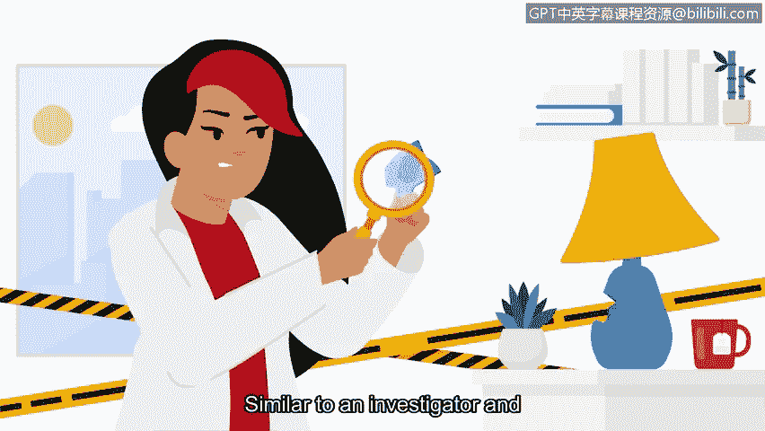

# 谷歌网络安全专业证书第一课：《信息安全基础》（中英字幕，前面分p中字，后面分p英字） - P36：6_01_core-skills-for-cybersecurity-professionals.en_subtitled - GPT中英字幕课程资源 - BV1Bk4y1u7KL

For any job， you need certain skills to be successful。

 and many of these core skills are transferable from one role to the next。😊。

No matter what job you currently have， you likely have many core skills already。

Having a diverse background enhances your core skills。

 which means your personal experiences and perspectives are especially valuable。 In this video。

 we'll discuss both transferable and technical skills that are particularly useful for a security analyst。

 Transferable skills are skills from other areas that can apply to different careers。

 Technical skills may apply to several professions as well。 However， at times。

 they may require knowledge of specific tools， procedures and policies。😊。

Let's discuss some core transferable skills you may already have that will benefit you in a career as a security analyst。

 Communication is a transferable skill for a security analyst。

 They will often need to describe certain threats， risks or vulnerabilities to people who may not have a technical background。

For example， security analysts may be tasked with interpreting and communicating policies and procedures to other employees。

Or analysts may be asked to report findings to their supervisors so the appropriate actions can be taken to secure the organization。

Another transferable skill is collaboration。 Security analysts often work in teams with engineers。

 digital forensic investigators and program managers。 For example。

 if you are working to roll out a new security feature。 you will likely have a project manager。

 an engineer and an ethical hacker on your team。 Security analysts also need to be able to analyze complex scenarios that they may encounter。

 For example， a security analyst may need to make recommendations about how different tools can support efficiency and safeguard organization's internal network。

😊，The last transferable skill that we'll discuss is problem solving。

 identifyingdentifying a security problem and then diagnosing it and providing solutions is a necessary skill to keep business operations safe。

 Understanding threat actors and identifying trends can provide insight on how to handle future threats。

Okay。Now that we've covered some important transferable skills。

 let's discuss some technical skills that security analysts need to develop。

A basic understanding of programming languages is an important skill to develop。

 because security analysts can use programming to automate tasks and identify error messages。

 like learning any other language Learn a programming language may seem challenging at first。

 However， this certificate program assumes no prior programming experience。

 So we'll start at the very beginning and provide several opportunities for hands on practice with languages like Python and SQL。

😊，Another important technical skill is knowing how to use security information and event management or Sim tools。

 Security professionals use Sim tools to identify and analyze security threats。

 risks and vulnerabilities。 For example， A Sim tool may alert you that an unknown user has access the system。

In the event of an unknown user accessing the system。

 you may use computer forensics to investigate the incident。Now， let's discuss computer forensics。

Similar to an investigator and a forensic scientist working in the criminal justice system。

Digital forensic investigators will attempt to identify。

 analyze and preserve criminal evidence within networks， computers and electronic devices。

 Keep in mind that you may already have some of the core skills we've discussed。

 And if you don't have the technical skills， That's okay。

 This program is designed to support you in learning those skills。For example。

 over the past seven years working in cybersecurity。

 I have learned that security analysts need to have intellectual curiosity and the motivation to keep learning in order to succeed。

 Personal， I dedicate time on a regular basis towards learning more Python and SQL skills in order to meet the demands of the projects I'm working on。

😊，You'll get to learn about Python and SQL later in this program。As you continue this journey。

 you'll build the knowledge and skills you need to enter the security field。

