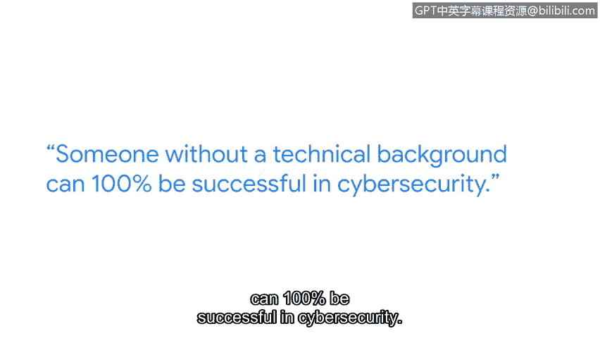

# 谷歌网络安全专业证书第一课：《信息安全基础》（中英字幕，前面分p中字，后面分p英字） - P37：7_02_veronica-my-path-to-working-in-cybersecurity.en_subtitled - GPT中英字幕课程资源 - BV1Bk4y1u7KL

Hi， I'm Veronica， I'm a security engineer at Google My journey into cybersecurity has changed my life for the better In so many ways the most important part is fulfilling work I get to do something that I absolutely love and that I'm super interested in and I feel very lucky that this is what I get to do for work before I entered my current field I had no idea what cybersecurity was my knowledge of cybersecurity was using secure passwords and that was about it So if you asked me you know what I be in cybersecurity five years ago I would have said what is that Someone without a technical background can 100% be successful in cybersecurity my path to my current role in cybersecurity started as an IT resident here at Google staffing tech stop I learned a lot of analytical thinking skills working out to helped us troubleshooting debugging I didn't realize I had transferable skills until I got into my role。

Cybersecurity and from there I took it upon myself to bug a bunch of security engineers interviewed a lot of them I didn't get here alone it took a village of mentors to get me here so don't be afraid to ask for help I don't think someone needs a college degree to go into cybersecurity some of the brightest minds that I get to work with don't have a college degree and so I think that's one of the best parts about the industry looking back at my career I wish I。

Would have known that I don't have to check all the boxes。

That I don't have to be an expert in the area to shoot my shot。

 and I also wish I would have known that perfectionism can get in the way of what you want to achieve。

