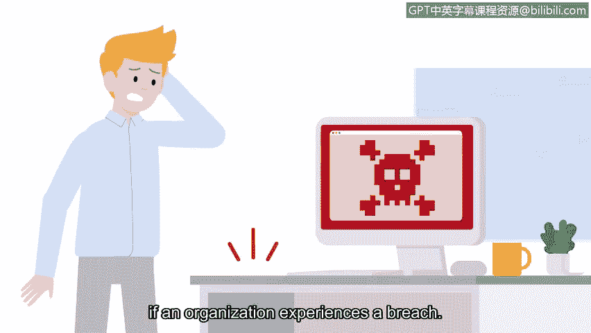

# 谷歌网络安全专业证书第一课：《信息安全基础》（中英字幕，前面分p中字，后面分p英字） - P38：8_04_the-importance-of-cybersecurity.en_subtitled - GPT中英字幕课程资源 - BV1Bk4y1u7KL

As we've discussed， security professionals protect many physical and digital assets。

These skills are desired by organizations and government entities because risk needs to be managed。

Let's continue to discuss why security matters。Security is essential for ensuring an organization's business continuity and ethical standing。

There are both legal implications and moral considerations to maintaining an organization's security。

A data breach， for example， affects everyone that is associated with the organization。

This is because data losses or leaks can affect an organization's reputation。

 as well as the lives and reputations of their users。

 clients and customers by maintaining strong security measures， Organs can increase user trust。

 This may lead to financial growth and ongoing business referrals。As previously mentioned。

 organizations are not the only ones that suffer during a data breach。Maintaining and securing user。

 customer and vendor data is an important part of preventing incidents that may expose people's personally identifiable information。

 Personal identifiable information known as P I is any information used to infer and individual's identity。

 P I I includes someone's full name， data birth， physical address， phone number， email address。

 Internet protocol or I P address and similar information。

 Senitive personally identifiable information known as S P I is a specific type of P I that falls under stricter handling guidelines and may include Social Security numbers。

 medical or financial information and biometric data such as facial recognition。If S P I I is stolen。

 this has the potential to be significantly more damaging to an individual than if P I I is stolen。

PII and SPII data are key assets that a threat actor will look for if an organization experiences a breach。

When a person's identifiable information is compromised， leaked， or stolen。

 identity theft is the primary concern。Identity theft is the act of stealing personal information to commit fraud while impersonating a victim。

And the primary objective of identity theft is financial gain。

We've explored several reasons why security matters。

 Employers need security analysts like you to fill the current and future demand to protect data。

 products and people while ensuring confidentiality， integrity and safe access to information。

This is why the US Bureau of Labor Statistics expects the demand for security professionals to grow by more than 30% by the year 2030。

So keep learning， and eventually you'll be able to do your part to create a safer and more secure environment for organizations and people alike。

😊。

