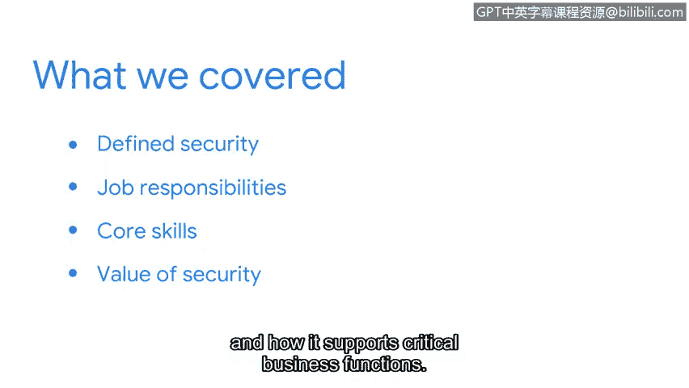

# 谷歌网络安全专业证书第一课：《信息安全基础》（中英字幕，前面分p中字，后面分p英字） - P39：9_01_wrap-up.en_subtitled - GPT中英字幕课程资源 - BV1Bk4y1u7KL

Congratulations on completing the first section of this course。

Let's quickly review what we've covered so far before moving on。

 We define security and introduce the benefits of implementing security in an organization。

 Then we discuss different job responsibilities such as managing threats and installing prevention software。

 we also introduce some important core skills like collaboration and computer forensics。

 We finished by discussing the value of security and how it supports critical business functions。

 I hope you've gained a greater understanding of security。

 If you feel like you need a refresher before moving on。

 You can always go back and review any content you're unsure about。😊。

By learning the basics， you are laying the foundation for the rest of your security career。

 Coming up， We'll explore some well known attacks that shape the security industry。

 I'm excited to continue this journey with you。😊。