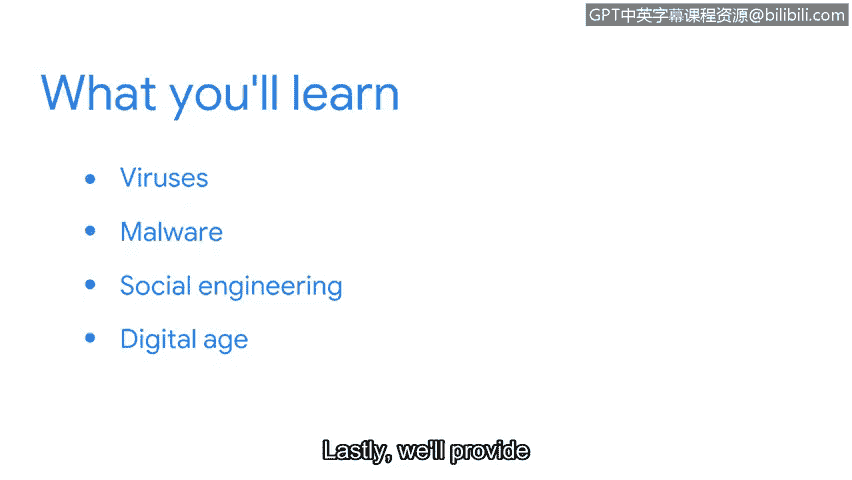
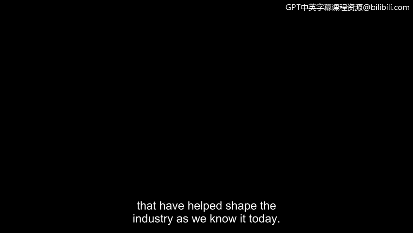

# 谷歌网络安全专业证书第一课：《信息安全基础》（中英字幕，前面分p中字，后面分p英字） - P40：10_01_welcome-to-week-2.en_subtitled - GPT中英字幕课程资源 - BV1Bk4y1u7KL

Welcome back。When it comes to security， there is so much to learn and I'm thrilled to be part of your career journey。

This is such an exciting time to be learning about security。

When I learned about international hacks that impacted both private companies and government organizations。

 I was inspired to want to work in security because I realized how dynamic and important this field is。

One reason there are so many jobs in the security field today is because of attacks that happened in the 1980s and 1990s。

 Des later， security professionals are still actively working to protect organizations and people from variations of these early computer attacks in this section of the course will discuss viruses in malware and introduce the concept of social engineering。

Then we'll discuss how the digital age ushered in a new era of threat actors。

Knowing the evolution of each attack is key to protecting against future attacks。Lastly。

 we'll provide an overview of eight security domains。

Next up， we'll travel back in time to explore some of the viruses， data breaches。

 and malware attacks that have helped shape the industry as we know it today。

