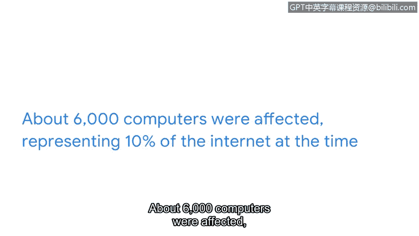

# 谷歌网络安全专业证书第一课：《信息安全基础》（中英字幕，前面分p中字，后面分p英字） - P41：11_02_past-cybersecurity-attacks.en_subtitled - GPT中英字幕课程资源 - BV1Bk4y1u7KL

The security industry is constantly evolving， but many present day attacks are not entirely new。

 Attackers often alter， or enhance previous methods。

Understanding past attacks can provide direction for how to handle or investigate incidents in your job as a security analyst。

 First， let's go over a couple of key terms that will support your understanding of the attacks we'll discuss。

A computer virus is malicious code written to interfere with computer operations and cause damage to data and software。

The virus attaches itself to programs or documents on a computer。

Then spreads and infects one or more computers in a network。

A worm is a type of computer virus that can duplicate and spread on its own。

 without human involvement。Today， viruses are more commonly referred to as malware。

 which is software designed to harm devices or networks。

Two examples of early malware attacks that we'll cover are the brain virus and the Morrisris wormorm。

They were created by Maware developers to accomplish specific tasks。However。

 the developers underestimated the impact their malware would have and the amount of infected computers there would be。

 Let's take a closer look at these attacks and discuss how they helped shape security as we know it today。

In 1986， the Alvi Brothers created the brain virus。

 although the intention of the virus was to track illegal copies of medical software and prevent pirated licenses。

 what the virus actually did was unexpected。 Once a person used a pirated copy of the software。

 the virus infected that computer。Then any disc that was inserted into the computer was also infected。

The virus spread to a new computer every time someone used one of the infected disks。 undetected。

 the virus spread globally within a couple of months。😊。

Although the intention was not to destroy data or hardware。

 the virus slowed down productivity and significantly impacted business operations。

The brain virus fundamentally altered the computing industry。

 emphasizing the need for a plan to maintain security and productivity。As a security analyst。

 you will follow and maintain strategies put in place to ensure your organization has a plan to keep their data and people safe。

Another influential computer attack was the Morris wormorm。In 1988。

 Robert Morris developed a program to assess the size of the Internet。

The program crawled the web and installed itself onto other computers to tally the number of computers that were connected to the internet。

Sounds simple， right？ The program， however， failed to keep track of the computers it had already compromised and continued to reinstall itself until the computers ran out of memory and crashed。

😊，About 6000 computers were affected representing 10 per of the Internet at the time。

 This attack cost millions of dollars in damages due to business disruptions and the efforts required to remove the worm。

 After the Morris wormm， Comp emergency response teams known as Certs were established to respond to computer security incidents。

Certs still exist today， but their place in the security industry has expanded to include more responsibilities。

Later in this program， you'll learn more about the core functions of these security teams and gain hands on practice with detection and response tools。

Early attacks played a key role in shaping the current security industry。 And coming up。

 we'll discuss how attacks evolved in the digital age。

