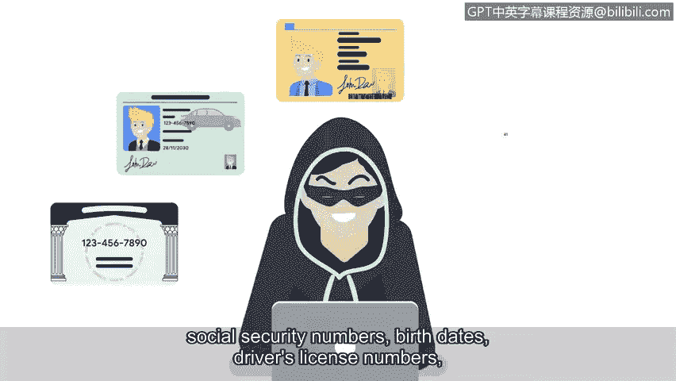

# 谷歌网络安全专业证书第一课：《信息安全基础》（中英字幕，前面分p中字，后面分p英字） - P42：12_03_attacks-in-the-digital-age.en_subtitled - GPT中英字幕课程资源 - BV1Bk4y1u7KL

With the expansion of reliable high speed internet。

 the number of computers connected to the Internet increased dramatically。😊。

Because malware could spread through the Internet， threatat actors no longer needed to use physical disks to spread viruses to better understand attacks in the digital age。

 We'll discuss two notable attacks that relied on the Internet。

The love letter attack and the Efax breach。In the year 2000。

 Onell de Guzman created the love letter malware to steal internet login credentials。

This attack spread rapidly and took advantage of people who had not developed a healthy suspicion for unsolicited emails。

Users received an email with the subject line。 I love you。

 Each email contained an attachment labeled love letter for you。 When the attachment was opened。

 the Maware scanned a user's address book。 Then it automatically sent itself to each person on the list and installed the program to collect user information and passwords。

 Reients would think they were receiving an email from a friend， but it was actually malware。😊。

The love letter ended up infecting 45 million computers globally and is believed to have caused over $10 billion in damages。

The love letter attack is the first example of social engineering。

 Social engineering is a manipulation technique that exploits human error to gain private information。

 access or valuables。After the love letter， attackers understood the power of social engineering。

The number of social engineering attacks is increasing with every new social media application that allows public access to people's data。

Many people are now prioritizing convenience over privacy。

The trade off of this evolving shift is that these tools may lead to increased vulnerability。

 if people do not use them appropriately。As a security professional。

 your role is to identify and manage inappropriate use of technology that may place your organization and all the people associated with it at risk。

One way to safeguard your organization is to conduct regular internal trainings。

 which you as a future security analyst， may be asked to lead or participate in。Today。

 it's common for employees to receive training on how to identify social engineering attacks。

Specifically， phishing through the emails they receive。

Fishing is the use of digital communications to trick people into revealing sensitive data or deploying malicious software。

Now， let's discuss the Equifax breach。 In 2017， attackers successfully infiltrated the credit reporting agency。

 Equifax。This resulted in one of the largest known data breaches of sensitive information。

Over 143 million customer records were stolen， and the breach affected approximately 40% of all Americans。

 The records included personally identifiable information， including Social Security numbers。

 birth dates， drivers's license numbers， home addresses and credit card numbers from a security standpoint。

 The breach occurred due to multiple failures on equifax's part。

It wasn't just one vulnerability that the attackers took advantage of。 There were several。

The company failed to take the actions needed to fix multiple known vulnerabilities in the months leading up to the data breach。

In the end， Equifax settled with the US Government and paid over $575 million to resolve customer complaints and cover required fines。

 while there have been other data breaches before and after the Efax breach。

 The large settlement with the US Government alerted companies to the financial impact of a breach and the need to implement preventative measures。

These are just a couple of well known incidents that have shaped the security industry。

Knowing about them will help you in your security career。

Understanding different types of malware and social engineering attacks will allow you to communicate about security risks during future job interviews as a future security professional。

 constantly adapting and educating yourself on threat actors。

 tactics and techniques will be a part of your job。By noticing similar trends。

 patterns and methodologies， you may be able to identify a potential breach and limit future damage。

Finally， understanding how security affects people's lives is a good reminder of why the work you will do is so important。

