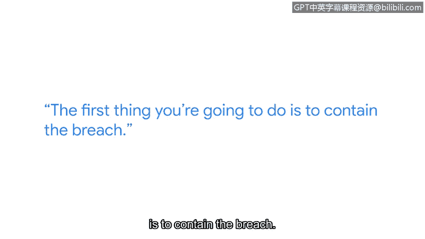

# 谷歌网络安全专业证书第一课：《信息安全基础》（中英字幕，前面分p中字，后面分p英字） - P43：13_05_sean-keep-your-cool-during-a-data-breach.en_subtitled - GPT中英字幕课程资源 - BV1Bk4y1u7KL

Hi， my name is Sean， I am a technical program manager in Google Workspace I。

A 30 year security veteran。Within the security space across six different industries。

 during your first data breach， the most important thing that you can do。Is keep your cool。

 Everyone around。Is going to be freaking out If you are on the security team and you are managing the incident。

 you have to legitimately be the cool guy in the room。Be that person that has the pause。

In the conversation。Somebody might be like， do you know what's going on？I absolutely do。

I think the biggest breach。I've ever had。Was a phone call， an engineer for another financial。

 but a server off ebay。That server。Fired it up hadn't been wiped，20 million credit cards。

 recordss were on it。 They triggered a whole review of。

We had not been controlling for how to third parties， because we were now outsourcing data centers。

 How do third parties wipe the servers that we no longer use。

The first thing you're going to do is to contain a breach if you are still hemorrhaging data。

 you go through your progressions to stop hemorrhaging data。

So if that means shutting down a server， shutting down a data center， shutting down comms。

 whatever stopping the data loss is， that is your number one priority。

 Your job as an incident manager or as somebody working a breach is to stop the breach and then investigate the breach。

 So executing your incident management by plan is the most important thing that an entry level person can keep in mind。

