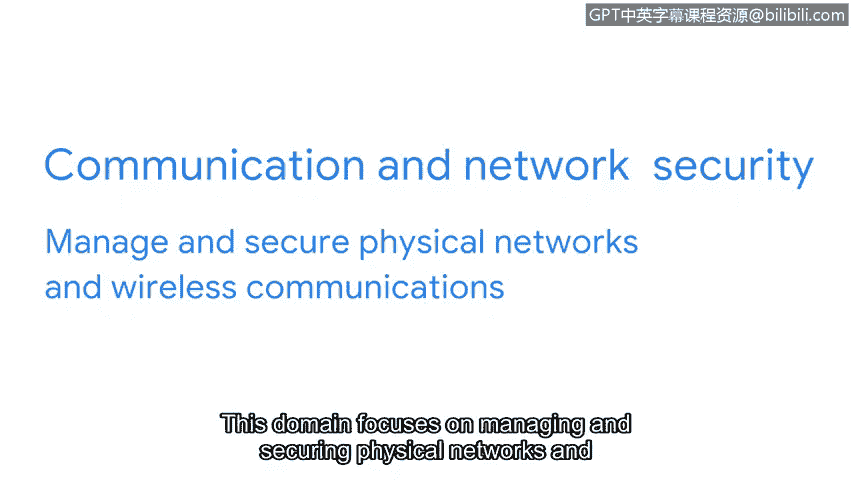

# 谷歌网络安全专业证书第一课：《信息安全基础》（中英字幕，前面分p中字，后面分p英字） - P44：14_01_introduction-to-the-eight-cissp-security-domains-part-1.en_subtitled - GPT中英字幕课程资源 - BV1Bk4y1u7KL

As the tactics of threat actors evolve， so do the roles of security professionals。

Having a solid understanding of core security concepts will support your growth in this field。

 One way to better understand these core concepts is by organizing them into categories called security domains。

As of 2022， CISSP has defined eight domains to organize the work of security professionals。

It's important to understand that these domains are related and that gaps in one domain can result in negative consequences to an entire organization。

It's also important to understand the domains because it may help you better understand your career goals and your role within an organization。

As you learn more about the elements of each domain。

 the work involved in one may appeal to you more than the others。

This domain may become a career path for you to explore further。C。

 I SSP defines eight domains in total， and will discuss all eight between this video and the next。

In this video， we're going to cover the first four。Security and risk management。Asset security。

 security， architecture and engineering。And communication and network security。

Let's start with the first domain， security and risk management。

Security and risk management focuses on defining security goals and objectives。 risk mitigation。

 compliance， business continuity， and the law。For example。

Security analysts may need to update company policies related to private health information If a change is made to a federal compliance regulation such as the Health Insurance Portability and Accountability Act。

 also known as HIA。The second domain is asset security。

This domain focuses on securing digital and physical assets。It's also related to the storage。

 maintenance， retention， and destruction of data。When working with this domain。

 security analysts may be tasked with making sure that old equipment is properly disposed of and destroyed。

Including any type of confidential information。 The third domain is security。

 architecture and engineering。This domain focuses on optimizing data security by ensuring effective tools。

 systems， and processes are in place。As a security analyst。

 you may be tasked with configuring a firewall。A firewall is a device used to monitor and filter incoming and outgoing computer network traffic。

Setting up a firewall correctly helps prevent attacks that could affect productivity。

The fourth security domain is communication and network security。

 This domain focuses on managing and securing physical networks and wireless communications。

As a security analyst， you may be asked to analyze user behavior within your organization。

Imagine discovering that users are connecting to unsecured wireless hotspots。

This could leave the organization and its employees vulnerable to attacks。

To ensure communications are secure， you would create a network policy to prevent and mitigate exposure。

Maintaining an organization's security is a team effort， and there are many moving parts。

As an entry level analyst， you will continue to develop your skills by learning how to mitigate risks to keep people and data safe。

You don't need to be an expert in all domains， but having a basic understanding of them will aid you in your journey as a security professional。

 You're doing great。 We have just introduced the first four security domains。 And in the next video。

 we'll discuss four more。 See you soon。