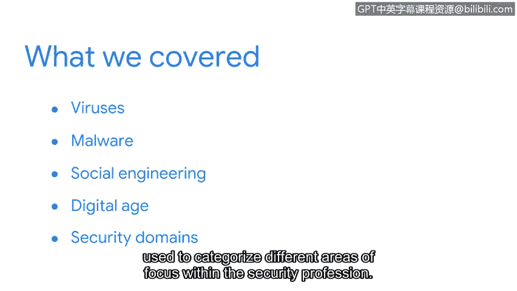

# 谷歌网络安全专业证书第一课：《信息安全基础》（中英字幕，前面分p中字，后面分p英字） - P46：16_01_wrap-up.en_subtitled - GPT中英字幕课程资源 - BV1Bk4y1u7KL

This concludes our brief introduction to some of the most influential security attacks throughout history and CIS SP's8 security domains。

Let's review what we've discussed。 First， we covered viruses。

 including the brain virus and the Morrisris wormm and discussed how these early forms of malware shaped the security industry。

 We also discussed how many attacks today are variants of these early examples。

Understanding previous attacks is critical for security professionals who are working to protect organizations and people from possible future variants。

 We also discussed social engineering and threat actor motives by learning about the love letter attack and the Equifax data breach。

 These incidents showed the widespread impacts and associated costs of more recent security breaches in the digital age。

😊，Finally， we introduced CISSPs， eight security domains。

 and how they can be used to categorize different areas of focus within the security profession。

I hope you are feeling confident about your foundational security knowledge。

Learning the history of security can allow you to better understand the current industry。 C， I SSPs。

8 security domains provide a way to organize the work of security professionals。Remember。

 every security professional is essential。Your unique point of view。

 professional background and knowledge are valuable。

So the diversity you bring to the field will further improve the security industry as you work to keep organizations and people safe。

