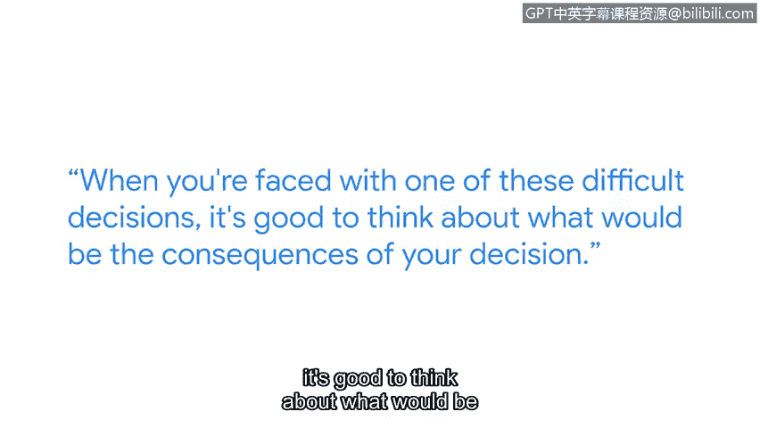
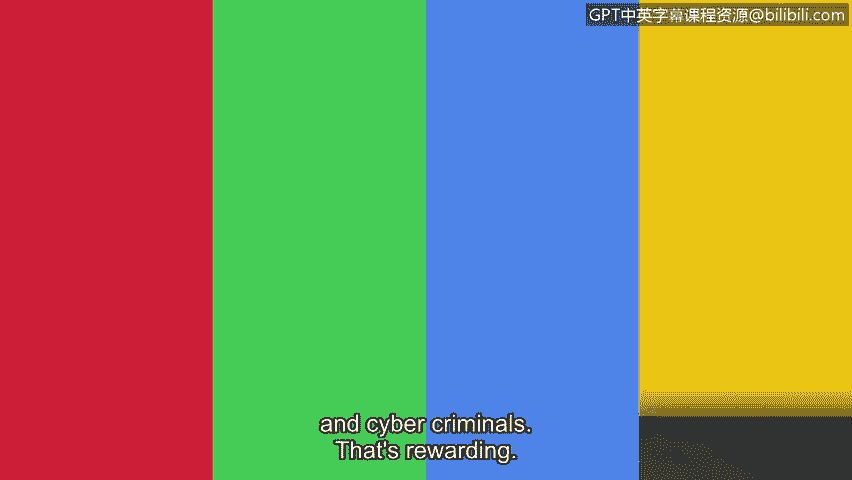

# 谷歌网络安全专业证书第一课：《信息安全基础》（中英字幕，前面分p中字，后面分p英字） - P52：22_03_holly-the-importance-of-ethics-as-a-cybersecurity-professional - GPT中英字幕课程资源 - BV1Bk4y1u7KL

Hi， I'm Holly， and I'm a cloud security architect with Google Cloud。

 At the beginning of my adult career， I sold Hosiery while I was going to school that LED me into an opportunity to work in banking。

 which then LED me into an opportunity to work in telecommunications。 And from there。

 I managed to get myself into a security vendor and learn security。

 Part of the way that I was able to change from my original half of my tech career being a database administrator to getting into cybersecurity。

 was through getting certificates like you're doing today。

 Those really helped me gain credibility with potential employers when I didn't have the experience in this particular field yet。

😊，Ethics are really the crux of cybersecurity。 You need to be able to be ethical in all of your actions in order to be a cybersecurity professional。

 Exles of unethical behavior are usually honestly just slightly laziness people taking shortcuts and not really thinking about the consequences of their actions。

 So certainly when people share passwords to systems or give out private information or look into systems for their own personal information or or purposes for people about people they know or about celebrities。

 One of the most difficult situations that I ever faced in my technology career related to ethics was shortly after 9/11 my boss's boss's boss came to me with a bunch of key keywords that were clearly related to the attack in New York and asked me to query。

The database that I administered that had everybody's text messages in it for the entire telecommunications company without anything in writing and without a court order。

 I was in a very uncomfortable position to tell someone that much senior than me that I wasn't comfortable doing that。

 I suggested that he bring something in writing to me to do that。

 And he found someone else who did it for him。 When you're faced with one of these difficult decisions。

 it's good to think about what would be the consequences of your decision。

 My encouragement to those of you out here taking this program is that the rewards that you get from helping to protect your company or your users or your organization from cyber criminals is is really great。

 We get to be the good guys and help protect our industry and our customers from cyber attacks and cyber criminals。

 That's rewarding。😊。

