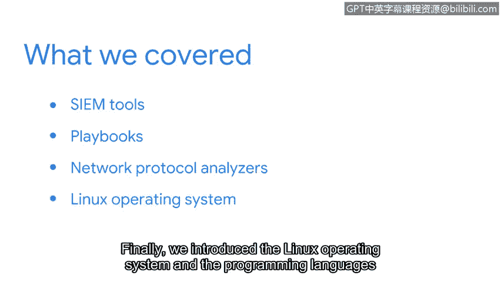

# 谷歌网络安全专业证书第一课：《信息安全基础》（中英字幕，前面分p中字，后面分p英字） - P57：27_01_wrap-up.en_subtitled - GPT中英字幕课程资源 - BV1Bk4y1u7KL

That completes the introduction to security tools and programming languages。

In this section of the course， we covered SIim tools such as Splunk and Chronicle。

 We also discussed how SIim tools are used by security analysts to complete different tasks。

Then we discussed other tools such as playbooks and network protocol analyzers。

 also called packetet Snis。Finally， we introduced the Linux operating system and the programming languages。

 SQL and Python。

Remember， the tools we discuss take time to understand completely。

 but having a basic understanding of these tools can help you get a job in the security field and progress in your career。

