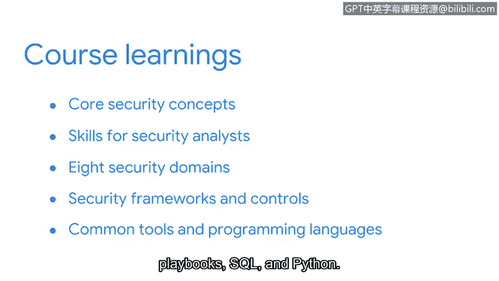

# 谷歌网络安全专业证书第一课：《信息安全基础》（中英字幕，前面分p中字，后面分p英字） - P58：28_01_course-wrap-up.en_subtitled - GPT中英字幕课程资源 - BV1Bk4y1u7KL

Congratulations on completing the first course。 We've come so far and covered so much about a really exciting industry。

😊，I find cybersecurity to be exciting because it's dynamic， there are always new puzzles to solve。

 and the work of protecting our users is worthwhile。Before we move on。

 let's take a moment to celebrate and reflect on what we've covered。 First。

 we introduced core security concepts， including what security is and why it matters。

 We also discussed what an entry level security analyst does， and some skills related to the rule。

 Then we transitioned to8 security domains， which include security and risk management。

 asset security and security operations。 Next， we highlighted security frameworks and controls。

 specifically， the CIA triad model and the NISist cyberse framework。 Finally。

 we explored common tools and programming languages used by security analysts， such as Sims。

 playbooks， SQL and Python。😊。

I hope you're proud of the work you've done so far。

No matter what direction you take in the security industry。

 everything you've learned lays the foundation for the next phase of your career。

And as you move through this program， you'll have the chance to develop your skills further。

In the next course， we will provide more details about several of the topics introduced in this course。

Hi， I'm Ashley， and I will be guiding you through the next course of this certificate program。

 We'll discuss security domains and business operations in greater detail。😊。

I'm so glad I was able to be here for the beginning of your journey。 You're off to a great start。

 I'm excited for you to reach your goal of joining the security industry。😊。

