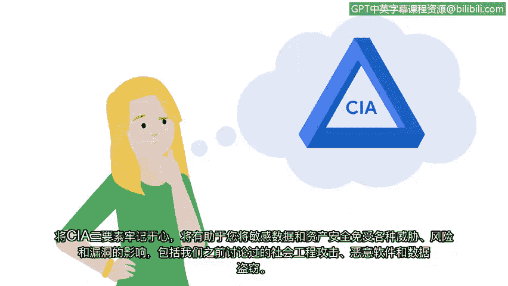

# 谷歌网络安全专业证书第二课：《安全风险管理》（中英字幕，前面分p中字，后面分p英字） - P14：13_探索CIA三元模型.zh - GPT中英字幕课程资源 - BV1wX4y177AS

Great to see you again。While working as an entry level security analyst。

 your main responsibility is to help protect your organization's sensitive assets and data from threat actors。

The C Triad is a core security model that will help you do that。In this video。

 we'll explore the CIA triad and discuss the importance of each component for keeping an organization safe from threats。

 Ri and vulnerabilities。 Let's get started。 The CIA triad is a model that helps inform how organizations consider risk when setting up systems and security policies。

 As a reminder， the three letters in the CIA triad stand for confidentiality。

 integrity and availability。 As an entry level analyst。

 you'll find yourself constantly referring to these three core principles。

 As you work to protect your organization and the people it serves。

 confidentiality means that only author users can access specific assets or data。

Sensitive data should be available on a need to know basis so that only the people who are authorized to handle certain assets or data have access。

 Integrity means that the data is correct， authentic and reliable。

Determining the integrity of data and analyzing how it's used will help you as a security professional。

 decide whether the data can or cannot be trusted。 Availability means that the data is accessible to those who are authorized to access it。

Inaccessible data isn't useful and can prevent people from being able to do their jobs。

As a security professional， ensuring that systems， networks。

 and applications are functioning properly to allow for timely and reliable access may be a part of your everyday work responsibilities。

Now that we've defined the CIA triad and its components。

 let's explore how you might use the CIA triad to protect an organization if you work for an organization that has large amounts of private data like a bank the principle of confidentiality is essential because a bank must keep people's personal and financial information safe。

 the principle of integrity is also a priority， for example。

 if a person's spending habits or purchasing locations change dramatically。

 the bank will likely disable access to the account until they can verify that the account owner not a threat actor is actually the one making purchases。

The availability principle is also critical。Banks put a lot of effort into making sure that people can access their account information easily on the web。

And to make sure that information is protected from threat actors。

 banks use a validation process to help minimize damage if they suspect that customer accounts have been compromised。

As an analyst， you'll regularly use each component of the triad to help protect your organization and the people it serves。

And having the CIA Triad constantly in mind will help you keep sensitive data and assets safe from a variety of threats。

 risks， and vulnerabilities， including the social engineering attacks。

 malware and data theft we discussed earlier。

Coming up， we'll explore specific frameworks and principles that will also help you protect your organization from threats。

 risks and vulnerabilities， see you soon。