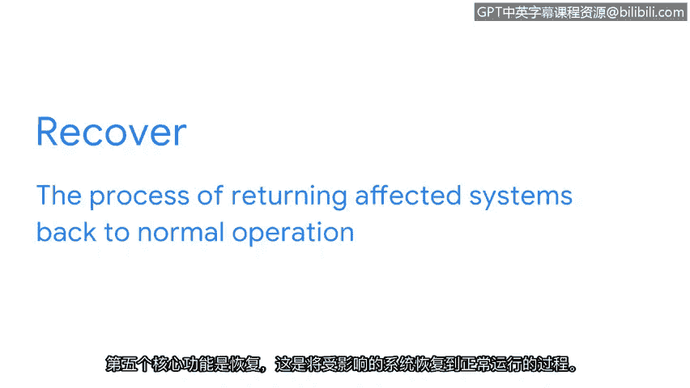

# 谷歌网络安全专业证书第二课：《安全风险管理》（中英字幕，前面分p中字，后面分p英字） - P16：15_探索NIST网络安全框架的五个功能.zh - GPT中英字幕课程资源 - BV1wX4y177AS

Hello again。 I'm excited。 You're here。 We have so much to discuss。😊，Previously。

 we covered the uses and benefits of the NISist CSF。 In this video。

 we'll focus specifically on the five core functions of the NISist CSF framework。 Let's get started。

 NISist CSF focuses on five core functions。 identifyify， protect。Detect， respond and recover。

These core functions help organizations manage cybersecurity risks。

 implement risk management strategies， and learn from previous mistakes， Basically。

 when it comes to security operations， NIS CSF functions are key for making sure an organization is protected against potential threats。

 risks and vulnerabilities。So let's take a little time to explore how each function can be used to improve an organization's security。

The first core function is identifyify， which is related to the management of cybersecurity risk and its effect on an organization's people and assets。

 For example， as a security analysts， you may be asked to monitor the systems and devices and your organization's internal network to identify potential security issues like compromised devices on the network。

The second core function is Pro， which is the strategy used to protect an organization through the implementation of policies。

 procedures， training， and tools that help mitigate cybersecurity threats。For example。

 as a security analyst， you and your team might encounter new and unfamiliar threats and attacks For this reason。

 studying historical data and making improvements to policies and procedures is essential。

 The third core function is detect。 Which means identifying potential security incidents and improving monitoring capabilities to increase the speed and efficiency of detections。

For example。As an analyst， you might be asked to review a new security tool set up to make sure it's flagging low。

 medium or high risk and then alerting the security team about any potential threats or incidents。

 The fourth function is respond。 which means making sure that the proper procedures are used to contain。

 neutralize and analyze security incidents and implement improvements to the security process。

As an analyst， you could be working with a team to collect and organize data to document an incident and suggest improvements to processes to prevent the incident from happening again。

The fifth core function is recover， which is the process of returning affected systems back to normal operation。

For example， as an entry level security analyst， you might work with your security team to restore systems。

 data， and assets such as financial or legal files that have been affected by an incident like a breach。

We've covered a lot of information in this video， hopefully it helped you understand the value of learning about NIST CSF and its five core functions。

From proactive to reactive measures， all five functions are essential for making sure that an organization has effective security strategies in place。

 Security incidents are going to happen， but an organization must have the ability to quickly recover from any damage caused by an incident to minimize their level of risk。

Coming up， we'll discuss security principles that work hand in hand with NIST frameworks and the CIA Triad to help protect critical data and assets。

