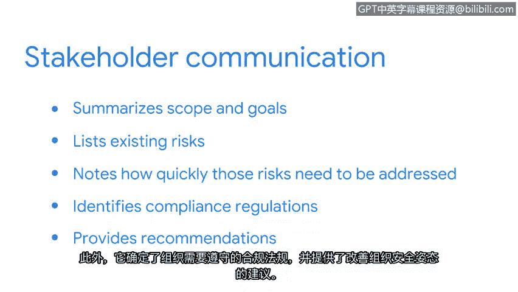

# 谷歌网络安全专业证书第二课：《安全风险管理》（中英字幕，前面分p中字，后面分p英字） - P20：19_完成安全审核.zh - GPT中英字幕课程资源 - BV1wX4y177AS

Previously， we discussed the initial planning elements of an internal security audit。 In this video。

 we'll cover the final elements that an entry level analyst might be asked to complete。

 As a reminder， the planning elements of internal security audits include establishing the scope and goals。

 then conducting a risk assessment。😊，The remaining elements are completing a controls assessment。

 assessing compliance， and communicating results。Before completing these last three elements。

 you'll need to review the scope and goals as well as the risk assessment and ask yourself some questions。

For example， what is the audit meant to achieve？Which assets are most at risk。

 Are current controls sufficient to protect those assets？If not。

 what controls and compliance regulations need to be implemented？

Considering questions like these can support your ability to complete the next element。

 a controls assessment。A controls assessment involves closely reviewing an organization's existing assets。

 then evaluating potential risks to those assets to ensure internal controls and processes are effective。

To do this， entry level analysts might be tasked with classifying controls into the following categories。

 administrative controls， technical controls and physical controls。

 Ad controls are related to the human component of cybersecurity。

 They include policies and procedures that define how an organization manages data。

 such as the implementation of password policies。 technical controls are hardware and software solutions used to protect assets。

 such as the use of intrusion detection systems or Iss and encryption。

Physical controls refer to measures put in place to prevent physical access to protected assets。

 such as surveillance cameras and locks。The next element is determining whether or not the organization is adhering to necessary compliance regulations。

As a reminder， compliance regulations are laws that organizations must follow to ensure private data remains secure。

In this example， the organization conducts business in the European Union and accepts credit card payments。

 so they need to adhere to the GDPR and payment card industry data security standard or PCI， DSS。

 The final common element of an internal security audit is communication。

 Once the internal security audit is complete， results and recommendations need to be communicated to stakeholders。

 In general， this type of communication summarizes the scope and goals of the audit。😡。

Then it lists existing risks and notes how quickly those risks need to be addressed。Additionally。

 it identifies compliance regulations the organization needs to adhere to and provides recommendations for improving the organization's security posture。

Internal audits are a great way to identify gaps within an organization。

When I worked at a previous company， my team and I conducted an internal password audit and found that many of the passwords were weak。

Once we identified this issue， the compliance team took the lead and began enforcing stricter password policies。

 Aits are an opportunity to determine what security measures and organization has in place and what areas need to be improved to achieve the organization's desired security posture。

 Security audits are quite involved yet of extreme value to organizations。 Later in the course。

 you'll have an opportunity to complete elements of an internal security audit for a fictional company。

 which you can include in your professional portfolio。

