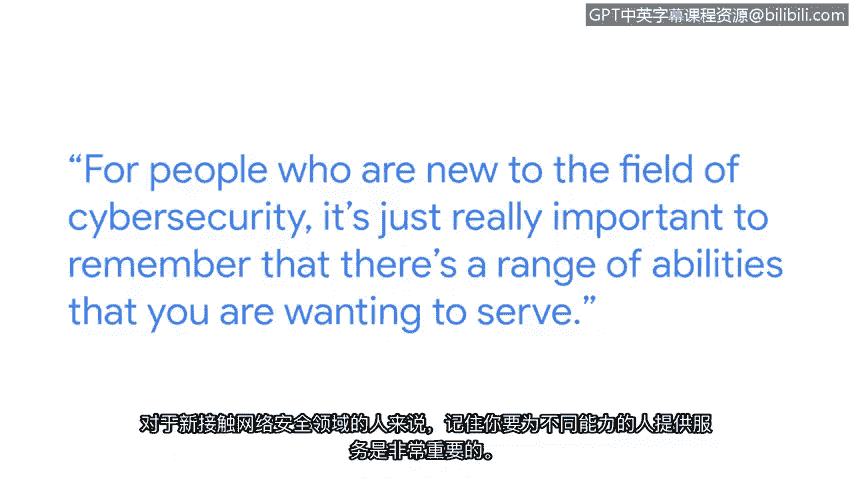

# 谷歌网络安全专业证书第二课：《安全风险管理》（中英字幕，前面分p中字，后面分p英字） - P25：24_帕里萨：可访问性和安全性的相似之处.zh - GPT中英字幕课程资源 - BV1wX4y177AS

My name is Parissa and I'm a vicece President of engineeringing and lead the Chrome team。

 so as general manager of the Chrome team， I lead a team of engineers and product managers and designers around the world to actually build Chrome and keep all of our users safe。

I think accessibility is important to all aspects of technology。

 And when we think about its relevance for cybersecurity， you know。

 we ultimately want to keep everybody as safe。 I think of accessibility as making information。

 activities or even environments， meaningful， sensible， usable to as many people as possible。

 And when we're talking about this in a technology standpoint。

It's usually about making information or services available to people with disabilities decisions we make based on our own abilities to enhance security can actually be ineffective for example。

 you'll sometimes see the color red used for indication of a warning well。

 for somebody who's colorbld like that is going to be ineffective and so really thinking about accessibility when we're trying to keep people safe is super important for them to be effective。

I've worked in the space of security for a really long time and I do see some parallels between the spaces。

 I've really been able to see innovation driven when you're trying to solve a very specific security problem or a specific accessibility problem closed captioning was originally designed and built to help。

People with hearing impairments， but it ends up helping everybody for people who are new to the field of cybersecurity。

 it's just really important to remember that there's a range of abilities that you are wanting to serve。

It's so important to get user research and feedback and a range of abilities in terms of testing the effectiveness of your security mitigations。

 I know it was scary for me early on， I didn't look like everybody else I really struggled with whether I belonged。

Finding people who could be mentors， having the courage to ask questions and recognize that you're rarely the only person with that question and just sort of persevering through sometimes hard moments can lead to breakthroughs and also just growing confidence。

 And one of the things I've learned is。Me having a different background than other people in this space was my own superpower instead of focusing on the delta between what I was and what the norm was in the room。

 I should feel a lot of pride in，What made me unique and what unique skills and perspective I brought to the table。

