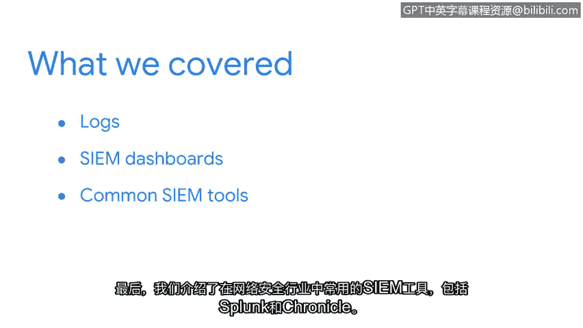

# 谷歌网络安全专业证书第二课：《安全风险管理》（中英字幕，前面分p中字，后面分p英字） - P28：27_总结.zh - GPT中英字幕课程资源 - BV1wX4y177AS

Let's quickly review what we covered in this section of the course。

 We started by discussing the importance of logs in cybersecurity。

 and we explored different log types like firewall network and server logs。 Next。

 we explored Sim dashboards and how they used visual representations to provide security teams with quick and clear insights into the security posture of an organization。

 Finally， we introduced common Sim tools used in the cybersecur industry。

 including Splunk and Chronle。

We'll be exploring even more security tools later in the program。

 and you'll have opportunities to practice using them Com up。

 we'll discuss playbooks and how they help security professionals respond appropriately to identify threats。

 risks and vulnerabilities。 Meet you there。