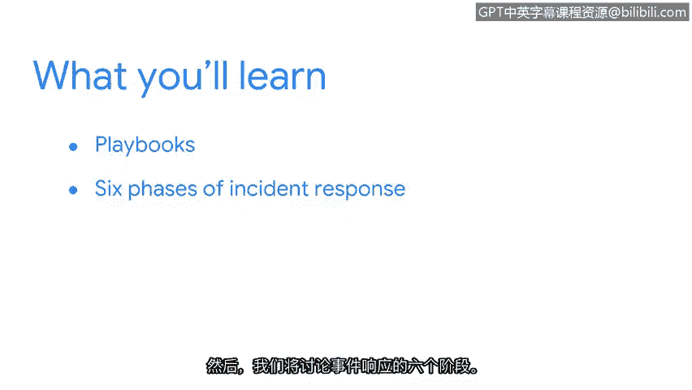

# 谷歌网络安全专业证书第二课：《安全风险管理》（中英字幕，前面分p中字，后面分p英字） - P29：28_欢迎来到第四周.zh - GPT中英字幕课程资源 - BV1wX4y177AS

Hello and welcome back。 You've reached the final section of this course。Previously。

 we discussed security， information and event management or Sim tools and how they can be used to help organizations improve their security posture。

 Let's continue our security journey by exploring another tool。 security professionals use Playbooks。

😊，In this section， we'll explore how playbooks help security teams respond to threats。

 Ri or vulnerabilities identified by Sim tools。 Then we'll discuss the six phases of incident response。

 Let's get started。

