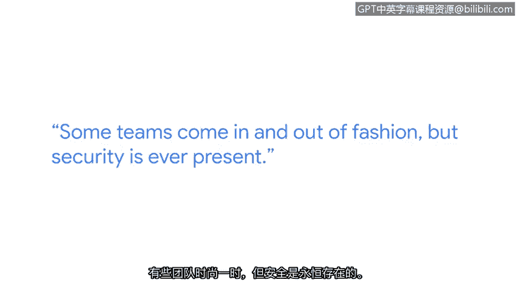

# 谷歌网络安全专业证书第二课：《安全风险管理》（中英字幕，前面分p中字，后面分p英字） - P31：30_扎克：事件响应和playbook的价值.zh - GPT中英字幕课程资源 - BV1wX4y177AS

My name is Zach， I'm a software engineer on the security team in Google Workspace。

 I have a nontraditional background when I graduated college I originally thought that I would pursue law。

 but I was accepted and I decided not to go instead I joined Google in recruiting and through that work I did a little bit of strategy work where I taught myself web scraping and I really liked it so I took one of Google's internal training courses that help me move from recruiting to software engineering processes in playbooks are documentation that software engineers and other people at Google use to determine how we can respond to things that happen whether that's a security or privacy incident whether that's an active attack。

 we have sets of guidelines or algorithms that we use to determine the best course of action to make sure that we manage people's data and security Well I'm relatively new to cybersecurity。

 I've been a software engineer here for about two years and I don't have enough knowledge to be able to respond to every single thing that could possibly come my way。

I'm on call or when I'm helping resolve a vulnerability。

 so the playbooks are super important to people like me and other folks who are joining the industry new because they allow you to solve the problem with the experience of a much more experienced person。

 basically decades of experience in your own resolution because you can rely on this playbook and other people's advice。

The kind of things that we use playbooks for are open attacks， privacy incidents， data leaks。

 denial of service attacks， service alerts and others When I first started out at Google my first task on this security team was to fix an externally reported vulnerability that means some security researcher out in the wild was playing with our app and found something that could potentially leak our users' data When I receive that it was my first task on the team looking back on it。

 I mean it's a relatively easy thing to solve but it felt really overwhelming at the time。

 but when we receive a vulnerability report， it comes with remediation guidance So there were steps in the bug that was sent to me saying this is the things that we think that you should do The things that I would say to somebody who's interested in starting out in cybersecurity is talk to as many people in the industry as you can you'll learn about what the job is like you'll learn about the skills that you need to get yourself there if that's something that you're interested in and you'll learn about open jobs and roles what it's like to work at different company。

I wish people had told me when I graduated college that like what these jobs are really like。

 I thought that coding would be like heads down typing away at a computer in a dark office for 12 hours a day。

 but it's not like that at all like you know， 50% is communicating with other people when reviewing designs and talking about ideas。

And that's really compelling。 and I think if somebody had said that to me at the beginning。

 my career would have been totally different。Some teams come in and out of fashion。

 but security is ever present。 It's really important now it's only getting more important。

 so there's a certain amount of security that comes with being in the security team。

Definitely a good place to be。