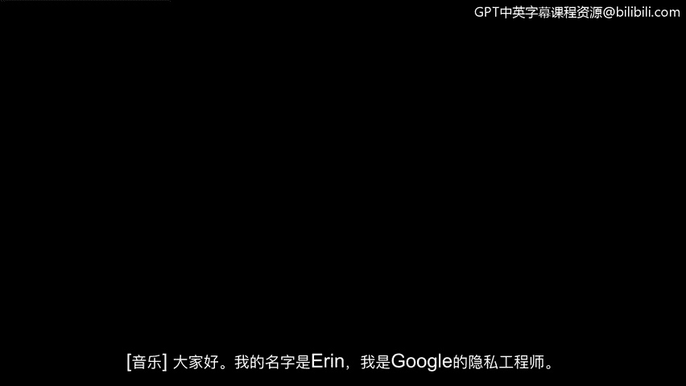
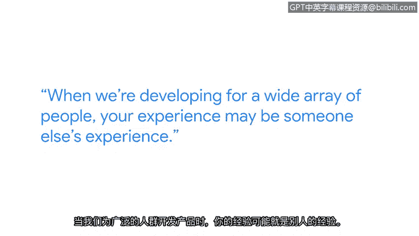

# 谷歌网络安全专业证书第二课：《安全风险管理》（中英字幕，前面分p中字，后面分p英字） - P33：32_艾琳：安全团队多样性的重要性.zh - GPT中英字幕课程资源 - BV1wX4y177AS

Hi everyone。 My name is Aaron and I am a privacy engineer at Google。

 I work on speculative and emerging technology so think of things that don't exist in the world and that are coming within the next two to five years My role is basically to take a look at all of the things that we are creating in terms of technology and making sure that privacy is embedded in that I am thinking for users before they even touch the product。

 making sure that when they utilize them， they'll have some form of trust in the engagement with that product as well as knowing that we are protecting their privacy things that they don't want to share or broadcast and making sure that they're informed before they even touch the product I always talk about soft skills being the most important thing over the technical skills because we can teach you anything but we can't teach you how to relate to people that is something that you bring to the table diversityver of thought and diversity of perspectives are very useful in understanding the world that we exist in because if we are。

Deigning products for everyday people。 we need everyday people to basically help us understand those perspectives because I may look at something one way。

 but my colleague may see it another way based on their own experiences and so when you work together and come from different environments you actually bring more equity and more depth to the things that you're looking at and the perspective that you bring is the essential voice that is required in order to make a product better when you look at people who work in journalism or people who like myself worked in entertainment。

 they are bringing a different perspective for how they would tackle something or if we have a product where we are trying to convince a product team that maybe we shouldn't do this it's always helpful to say you know from someone who worked in journalism do we really want this to end up in the times probably not and that is a way to come at people that on the ground floor。

 they understand what that looks like all of the experiences that you have had from the。

you were born to now they have been your experience and you have to think about that in terms of where we're going with technology when we're developing for a wide array of people。

 your experience may be someone else's experience and so if we don't have you in the room then we are missing the opportunity to actually bring something beautiful I would say to the equation。

 which is why I encourage people， please come you know work with us in terms of technology。

 get involved in STEM because the equity across products， security， privacy， you name it。

 whether it be you know software engineering。

Everything requires a different voice and it actually requires your voice。

