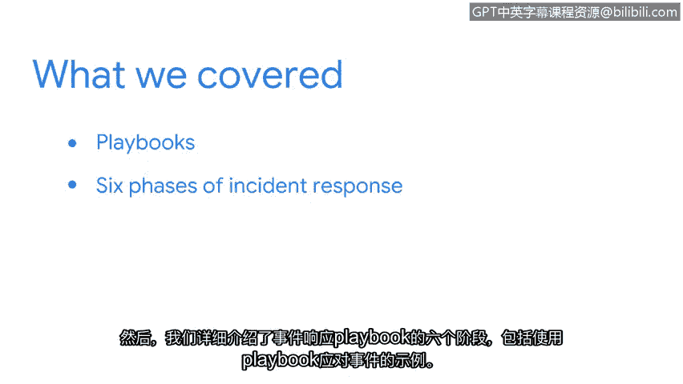

# 谷歌网络安全专业证书第二课：《安全风险管理》（中英字幕，前面分p中字，后面分p英字） - P34：33_总结.zh - GPT中英字幕课程资源 - BV1wX4y177AS

Let's review what we covered in this section。 We began by discussing the purpose of playbooks。

Then we examine the six phases of an incident response playbook。

 including an example of how a playbook might be used to address an incident。

Playbooks are just one of the essential tools you'll use as a security analyst。

 They provide a structured， consistent approach to handling security incidents and can help you respond to security incidents quickly。

 knowing how and when to use a playbook will allow you to make informed decisions about how to respond to a security incident when it occurs。

And help to minimize the impact and damage it may cause your organization and the people it serves following the steps of the playbook and communicating appropriately with your team will ensure your effectiveness as a security professional。

