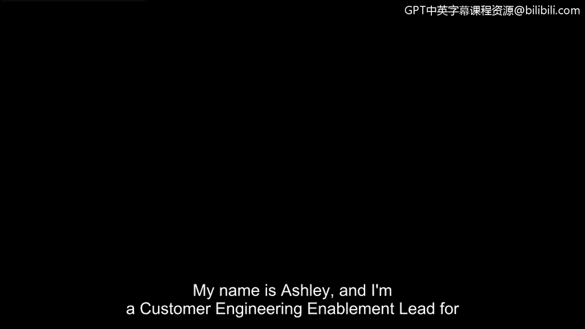
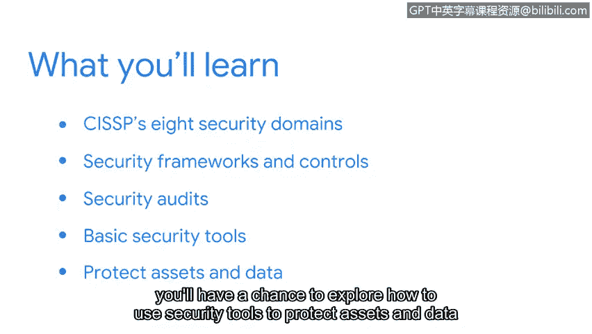

# 谷歌网络安全专业证书第二课：《安全风险管理》（中英字幕，前面分p中字，后面分p英字） - P36：0_01_introduction-to-course-2.en_subtitled - GPT中英字幕课程资源 - BV1wX4y177AS

My name is Ashley， and I am a customer engineering enablement lead for security operation sales at Google。

 I'm excited to be your instructor for this course。

 Let's start by quickly reviewing what we've covered so far。😊，Earlier。

 we defined security and explored some common job responsibilities for entry level analysts。

 We also discussed core skills and knowledge that analysts need to develop。

Then we shared some key events like the love letter and Morris attacks that LED to the development and ongoing evolution of the security field。

 We also introduce you to frameworks， controls and the CIA Triad。

 which are all used to reduce risk In this course we'll discuss the focus of certified information systems security professionals or CsSPs。

8 security domains。 We'll also cover security frameworks and controls in more detail with a focus on NIST's risk management framework。

Additionally， we'll explore security audits， including common elements of internal audits。

 then we'll introduce some basic security tools and you'll have a chance to explore how to use security tools to protect assets and data from threats。

 risks and vulnerabilities。😡。

Securing an organization and its assets from threats。

 risks and vulnerabilities is an important step in maintaining business operations In my experience as a security analyst。

 I hoped respond to a severe breach that cost the organization nearly $250000。

 So I hope you're feeling motivated to continue your security journey。 I know I'm excited。

 Let's get started。

