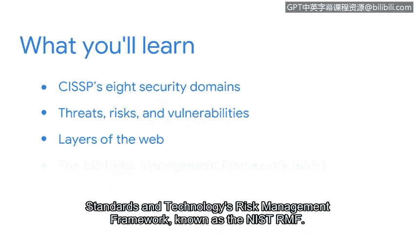

# 谷歌网络安全专业证书第二课：《安全风险管理》（中英字幕，前面分p中字，后面分p英字） - P37：1_01_welcome-to-week-1.en_subtitled - GPT中英字幕课程资源 - BV1wX4y177AS

The world of security， which we also refer to as cybersecurity throughout this program is vast。

 So making sure that you have the knowledge， skills and tools to successfully navigate this world is why we're here in the following videos you'll learn about the focus of CISSP's8 security domains。

 Then we'll discuss threats， risks and vulnerabilities in more detail。

 we'll also introduce you to the three layers of the web and share some examples to help you understand the different types of attacks that we'll discuss throughout the program。

Finally， we'll examine how to manage risks by using the National Institute of Standards and Techologies's Rik management F known as the NIST RMF。

Because these topics and related technical skills are considered core knowledge in the security field。

 continuinging to build your understanding of them will help you mitigate and manage the risks and threats that organizations face on a daily basis In the next video we'll further discuss the focus of the eight security domains introduce in the first course。

