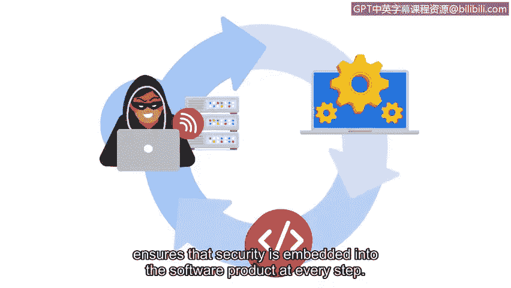

# 谷歌网络安全专业证书第二课：《安全风险管理》（中英字幕，前面分p中字，后面分p英字） - P39：3_03_explore-the-cissp-security-domains-part-2.en_subtitled - GPT中英字幕课程资源 - BV1wX4y177AS

In this video， we'll cover the last four domains， identity and access management。

 security assessment and testing， security operations and software development security。

 The fifth domain is identity and access management or IAM。

 and it's focused on access and authorization to keep data secure by making sure users follow established policies to control and manage assets。

As an entry level analyst， it's essential to keep an organization's systems and data as secure as possible by ensuring user access is limited to what employees need Basically。

 the goal of IAM is to reduce the overall risk to systems and data， for example。

 if everyone at a company is using the same administrator login。

 there is no way to track who has access to what data。In the event of a breach。

 separating valid user activity from the threat actor would be impossible。

There are four main components to IAM。Identification is when a user verifies who they are by providing a username。

 an access card， or biometric data such as a fingerprint。

Authentication is the verification process to prove a person's identity。

 such as entering a password or pen。Authorization takes place after a user's identity has been confirmed and relates to their level of access。

 which depends on the role in the organization。 Accountability refers to monitoring and recording user actions like login attempts to prove systems and data are used properly。

 The sixth security domain is security assessment and testing。

 This domain focuses on conducting security control testing。

 collecting and analyzing data and conducting security audits to monitor for risks。

 threats and vulnerabilities。Security control testing can help an organization identify new and better ways to mitigate threats。

 risks， and vulnerabilities。This involves examining organizational goals and objectives and evaluating if the controls being used actually achieve those goals。

Collecting and analyzing security data regularly also helps prevent threats and risks to the organization。

Analysts might use security control testing evaluations and security assessment reports to improve existing controls or implement new controls。

An example of implementing a new control could be requiring the use of multifactor authentication to better protect the organization from potential threats and risks。

Next， let's discuss security operations。The Security operations domain is focused on conducting investigations and implementing preventative measures。

Investigations begin once the security incident has been identified。

 this process requires a heightened sense of urgency in order to minimize potential risks to the organization。

If there is an active attack， mitigating the attack and preventing it from escalating further is essential for ensuring that private information is protected from threat actors。

 Once the threat has been neutralized， the collection of digital and physical evidence to conduct a forensic investigation will begin。

😡，A digital forensic investigation must take place to identify when， how and why the breach occurred。

This helps security teams determine areas for improvement and preventative measures that can be taken to mitigate future attacks。

The8 and final security domain is software development security。

 This domain focuses on using secure coding practices， As you may remember。

 secure coding practices are recommended guidelines that are used to create secure applications and services。

The Soft development Lifecycle is an efficient process used by teams to quickly build software products and features。

In this process， security is an additional step。By ensuring that each phase of the software development lifecycle undergoes security reviews。

 security can be fully integrated into the software product。 For example。

 performing a secure design review during the design phase。

 secure code reviews during the development and testing phases and penetration testing during the deployment and implementation phase ensures that security is embedded into the software product at every step。

 This keeps software secure and sensitive data protected and mitigates unnecessary risk to an organization。

 being familiar with these domains can help you better understand how they're used to improve the overall security of an organization and the critical role security teams' play。

 Next， we'll discuss security threats， risks and vulnerabilities。

 including ransomware and introduce you to the three layers of the web。

