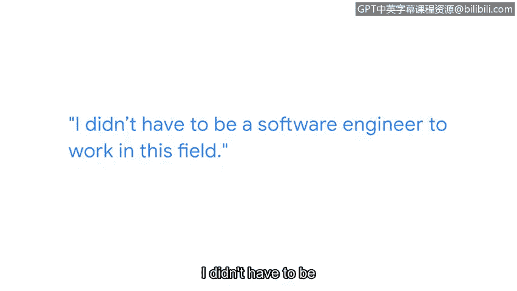
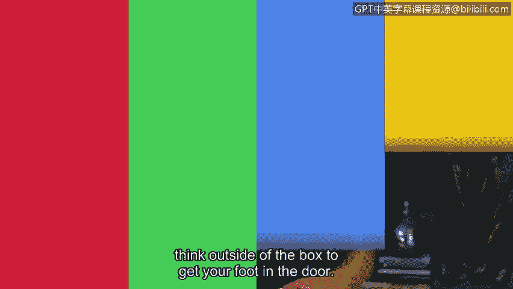

# 谷歌网络安全专业证书第二课：《安全风险管理》（中英字幕，前面分p中字，后面分p英字） - P40：4_05_ashley-my-path-to-cybersecurity.en_subtitled - GPT中英字幕课程资源 - BV1wX4y177AS

My name is Ashley and my role at Google is CE enableablement lead for Seop sales All that means is I helped set up training for customer engineers that support our products Gr it was a computer loved the internet I have one of the earliest A screen names in history and I'm very proud of that My dad's an engineer and I think there was always an interest in tech but when I got out of high school there wasn't a clear path to get there it wasn't a linear path at all So I was kind of a knucklehead growing up I gave up in 10th grade and I just didn't care for a long time and I was get in trouble a lot and I pretty much told myself if I don't join the military and get out of here I will probably not be here in about two to three years if I continue down this path So I joined the Army read out of high school graduated in June and four days later I was at boot camp at Fort Jackson。

 South Carolina as a trumpet player believe it or not I come back and had to get a job and。

wa not even tracking on tech jobs or anything like that so I was pulling in carts for a big hardware store selling video games。

 retail boxlinger for a freight company you know all of that stuff has happened before I even figured out the tech was an option The military was kind enough to retrain me in IT and that's kind of how I actually got the official first wave of schooling to be able to actually say hey。

 I have the skills to at least be a PC technician I went back to community college and I actually did find a cybersecurity associates degree program worked on some certifications I went to my first defcon which is a big hacking conference and that kind of set off a light bulb I think to actually get that clarity on what the path could look like I landed my first security analyst job back in 2017 and I went to a veterans training program at my last company that was free for vets。

up getting hired out of the training and I was with that company for almost five years before I came to Google So if you're new and you're just coming in you have to know how to work with a team。

 I think a lot of us learn that in customer service settings some of the skills I learned working in retail dealing with hard customers learning how to even talk to people or diffuse a situation if if people are upset about things just learning how to talk to people and in IT we need that you know it's no longer just the tech skills we need the more t shaped which you know there's soft skills there's people skills and there's technical skills you have to have good analysis skills And again。

 it doesn't even have to be technical analysis if you can read a book and pick apart you know the rhetorical devices of that story you can do analysis work。

I didn't have to be a software engineer to work in this field。

For many of us， there's like a math fear programming is a big hurdle， but we work with people。

 we work with processes and you don't necessarily need to have that coding knowledge to understand people or processes there's so many ways to break in so do not get discouraged and don't be scared to think outside of the box to get your foot in the door。

