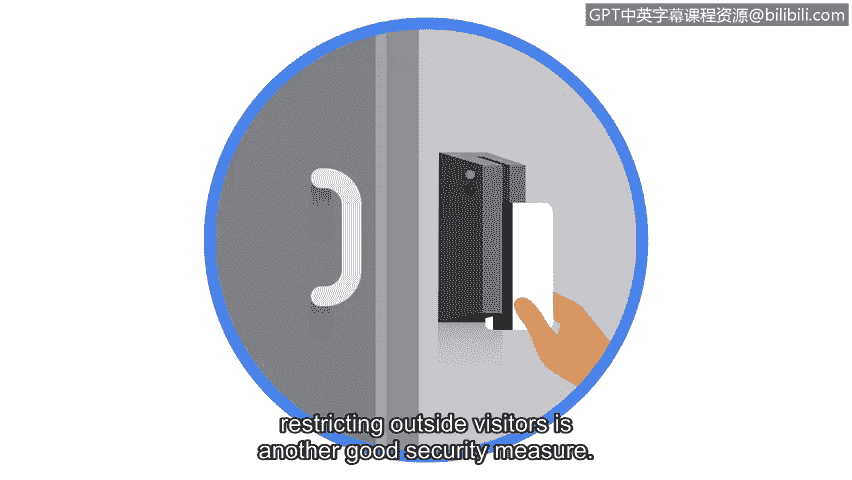

# 谷歌网络安全专业证书第二课：《安全风险管理》（中英字幕，前面分p中字，后面分p英字） - P41：5_01_threats-risks-and-vulnerabilities.en_subtitled - GPT中英字幕课程资源 - BV1wX4y177AS

As an entry level security analyst， one of your many roles will be to handle an organization's digital and physical assets。

As a reminder， an asset is an item perceived as having value to an organization。

During their lifespan， organizations acquire all types of assets， including physical office spaces。

 computers， customers PI， intellectual property， such as patents or copyrighted data and so much more。

 Unfortunately， organizations operate in an environment that presents multiple security threats。

 risks and vulnerabilities to their assets。 Let's review what threats。

 risks and vulnerabilities are and discuss some common examples of each。

 A threat is any circumstance or event that can negatively impact assets。

 One example of a threat is a social engineering attack。

 Social engineering is a manipulation technique that exploits human error to gain private information。

 access or valuables。Miicious links and email messages that look like they're from legitimate companies or people is one method of social engineering known as phishing。

As a reminder， phishing is a technique that is used to acquire sensitive data such as username。

 passwords or banking information risks are different from threats。

A risk is anything that can impact the confidentiality， integrity or availability of an asset。

 Think of a risk as the likelihood of a threat occurring。

 An example of a risk to an organization might be the lack of backup protocols for making sure its stored information can be recovered in the event of an accident or security incident。

Organizations tend to rate risks at different levels， low， medium， and high。

 depending on possible threats and the value of an asset。

A low risk asset is information that would not harm the organization's reputation or ongoing operations and would not cause financial damage if compromised。

 This includes public information such as website content or published research data。

A medium risk asset might include information that's not available to the public and may cause some damage to the organization's finances。

 reputation or ongoing operations。 For example， the early release of a company's quarterly earnings could impact the value of their stock。

A high risk asset is any information protected by regulations or laws， which if compromised。

 would have a severe negative impact on an organization's finances， ongoing operations or reputation。

This could include leaked assets with SPII， PII， or intellectual property。

Now let's discuss vulnerabilities。A vulnerability is a weakness that can be exploited by a threat。

 and it's worth noting that both a vulnerability and threat must be present for there to be a risk。

Examples of vulnerabilities include an outdated firewall， software or application， weak passwords。

 or unprotected confidential data。People can also be considered a vulnerability。

People's actions can significantly affect an organization's internal network， whether it's a client。

 external vendor， or employee， maintaining security must be a united effort。

So entry level analysts need to educate and empower people to be more security conscious。

 For example， educating people on how to identify a phishing email is a great starting point。

Using access cards to grant employee access to physical spaces while restricting outside visitors is another good security measure。

Organizations must continually improve their efforts when it comes to identifying and mitigating vulnerabilities to minimize threats and risks。

Entry level analysts can support this goal by encouraging employees to report suspicious activity and actively monitoring and documenting employees access to critical assets。

Now that you're familiar with some of the threats， risks。

 and vulnerabilities analysts frequently encounter coming up。

 we'll discuss how they impact business operations。

