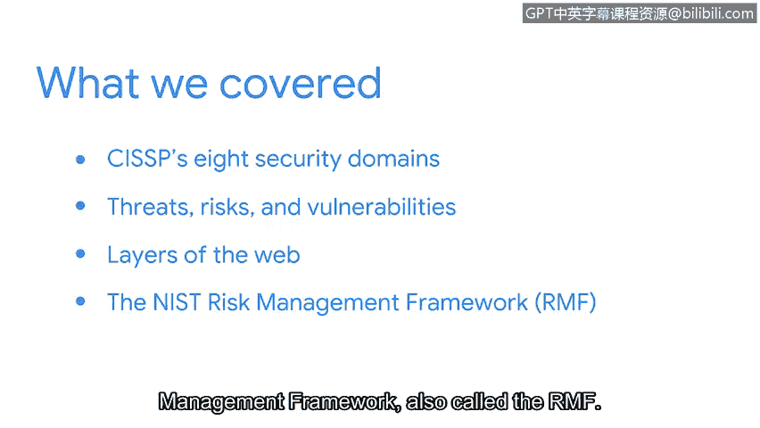

# 谷歌网络安全专业证书第二课：《安全风险管理》（中英字幕，前面分p中字，后面分p英字） - P45：9_01_wrap-up.en_subtitled - GPT中英字幕课程资源 - BV1wX4y177AS

You've now completed the first section of this course。 Let's review what we've discussed so far。

 We started out by exploring the focus of C I SP's 8 security domains。 Then we discussed threats。

 risks and vulnerabilities and how they can impact organizations。

 This included a close examination of ransomware and an introduction to the three layers of the web。

Finally， we focused on seven steps of the NIST risk management framework， also called the RMF。

You did a fantastic job adding new knowledge to your security analyst toolkit。In upcoming videos。

 we'll go into more detail about some common tools used by entry level security analysts。

 Then you'll have an opportunity to analyze data generated by those tools to identify risks。

 threats or vulnerabilities。 You'll also have a chance to use a playbook to respond to incidents。

 That's all for now。 Keep up the great work。

