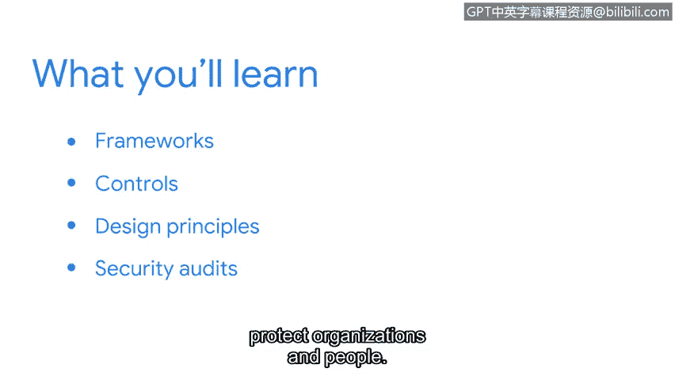

# 谷歌网络安全专业证书第二课：《安全风险管理》（中英字幕，前面分p中字，后面分p英字） - P46：10_01_welcome-to-week-2.en_subtitled - GPT中英字幕课程资源 - BV1wX4y177AS

Welcome back。As a security analyst， your job isn't just keeping organizations safe。

 Your role is much more important。 You're also helping to keep people safe。

Breaches that affect customers， vendors， and employees data can cause significant damage to people's financial stability and their reputations。

As an analyst， your day to day work will help keep people and organizations safe。

In this section of the course， we'll discuss security frameworks。

 controls and design principles in more detail and how they can be applied to security audits to help protect organizations and people。

 keepinging customer information， confidential is a crucial part of my daily work at Google。

 and the NISist cyberse framework plays a large part in this。

 The framework ensures the protection and compliance of customer tools and personal work devices through the use of security controls。

 Welcome to the world of security frameworks and controls。 Let's get started。

