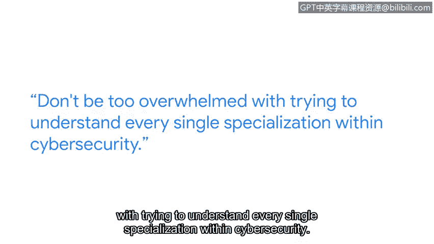

# 谷歌网络安全专业证书第二课：《安全风险管理》（中英字幕，前面分p中字，后面分p英字） - P53：17_03_wajih-stay-up-to-date-on-the-latest-cybersecurity-threats.en_subtitled - GPT中英字幕课程资源 - BV1wX4y177AS

。

My name is Waji and I'm a security engineer at Google working in the digital forensics department。

 Do you need a background in cybersecurity No you don't my past experiences is working at a water park as a snow con machine guy I worked at a movie theater selling popcorn and concession stands during my undergrad was a bio major at first like my freshman year met someone in a bus who was mentioning about this cool cybersecurity startup that just sounded cool like really cool some strategies I leverage to keep up to date on the latest cybersecurity trends is going on online forum such as medium to research different security trends and topics I personally use medium a lot as I could you know filter by the tag of like I want to find articles related to cybersecurity or I want to find articles related to cloud security。

Based off their filtering algorithm I just go on and see like what other people are talking about and then that's what helps me keep up to date if it's more of like networking that you're looking forward to then I highly recommend just going out to those conferences my advice for people wanting to get into cybersecurity is to don't be too overwhelmed with trying to understand every single specialization within cybersecurity there's so much going on within the cybersecurity field in terms of trends and it's nice to stay up to date with all of those but sometimes you need to take a step back and prioritize what subjects within cybersecurity you are staying most upto date like I love this job I love the challenges I feel like there is a shortage in cybersecurity professionals out there from just past experiences hearing from other friends and computer science fields most of them say that。

It's too hard， too complicated to get in don't listen to those people。

 I encourage you to push through， it's definitely well worth it。

 first just get the fundamentals down and be persistent。

