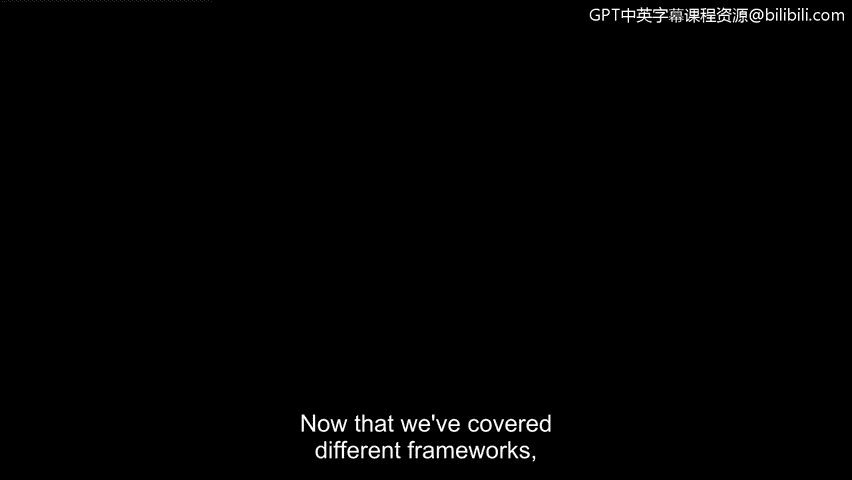
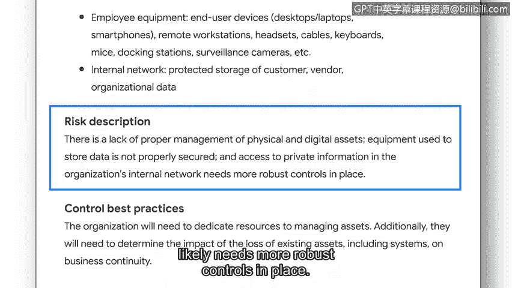

# 谷歌网络安全专业证书第二课：《安全风险管理》（中英字幕，前面分p中字，后面分p英字） - P54：18_04_plan-a-security-audit.en_subtitled - GPT中英字幕课程资源 - BV1wX4y177AS

Now that we've covered different frameworks， controls， security principles。

 and compliance regulations， the question is， how do they all work together？

The answer to that question is by conducting security audits。

 A security audit is a review of an organization's security controls。

 policies and procedures against a set of expectations。There are two main types of security audits。

 external and internal。We'll focus on internal security audits because those are the types of audits that entry level analysts might be asked to contribute to。

An internal security audit is typically conducted by a team of people that might include an organization's compliance officer。

 security manager， and other security team members。

Internal security audits are used to help improve an organization's security posture and help organizations avoid fines from governing agencies due to a lack of compliance。

 Internal security audits help security teams identify organizational risk。

 assess controls and correct compliance issues。 Now that we've discussed the purposes of internal audits。

 Let's cover some common elements of internal audits。

These include establishing the scope and goals of the audit。

 Coning a risk assessment of the organization's assets， completing a controls assessment。

 assesssing compliance， and communicating results to stakeholders。 In this video。

 we'll cover the first two elements， which are a part of the audit planning process。

 establishing the scope and goals， then completing a risk assessment。

 Spe refers to the specific criteria of an internal security audit。

 Scope requires organizations to identify people， assets， policies。

 procedures and technologies that might impact an organization's security posture。

Goals are an outline of the organization's security objectives or what they want to achieve in order to improve their security posture。

 although more senior level security team members and other stakeholders usually establish the scope and goals of the audit。

 entry level analysts might be asked to review and understand the scope and goals in order to complete other elements of the audit。

As an example， the scope of this audit involves assessing user permissions。

 identifying existing controls， policies， and procedures。

 and accounting for the technology currently in use by the organization。

The goals outlined include implementing core functions of frameworks like the NIS CSF。

 establishing policies and procedures to ensure compliance and strengthening system controls。

The next element is conducting a risk assessment which is focused on identifying potential threats。

 risks， and vulnerabilities。This helps organizations consider what security measures should be implemented and monitored to ensure the safety of assets。

Similar to establishing the scope and goals， a risk assessment is oftentimes completed by managers or other stakeholders。

 However， you might be asked to analyze details provided in the risk assessment to consider what types of controls and compliance regulations need to be in place to help improve the organization's security posture。

For example。This risk assessment highlights that there are inadequate controls。

 processes and procedures in place to protect the organization's assets。 specifically。

 there is a lack of proper management of physical and digital assets， including employee equipment。

The equipment used to store data is not properly secured and access to private information stored in the organization's internal network likely needs more robust controls in place。

 Now that we've discussed the initial planning elements of an internal security audit Com up。

 we'll focus on the last three elements。

