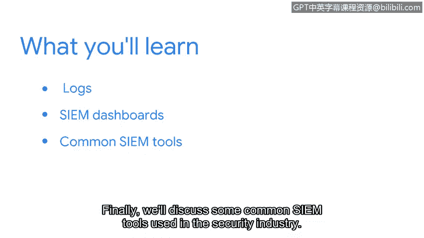

# 谷歌网络安全专业证书第二课：《安全风险管理》（中英字幕，前面分p中字，后面分p英字） - P57：21_01_welcome-to-week-3.en_subtitled - GPT中英字幕课程资源 - BV1wX4y177AS

Welcome back。Previously， we discussed security frameworks， controls， and design principles。

 and how security professionals apply these two security audits in this section。

 we'll continue to explore security tools and how they can help you keep organizations and the people they serve safe。

Security professionals often use a variety of tools to address specific security challenges such as collecting security data。

 detecting and analyzing threats， or automating tasks。

Security tools help organizations achieve a more comprehensive security posture。

We'll begin by covering different types of logs， what they track and how they're used。

 Then we'll explore security， information and event management， otherwise known as Sim dashboards。

 Finally， we'll discuss some common Sim tools used in the security industry。 Let's get started。

