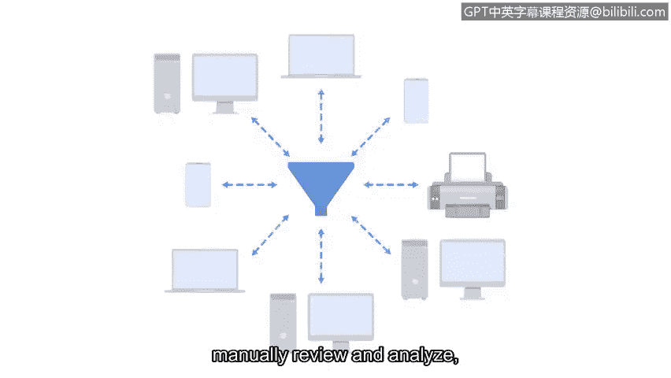

# 谷歌网络安全专业证书第二课：《安全风险管理》（中英字幕，前面分p中字，后面分p英字） - P58：22_02_logs-and-siem-tools.en_subtitled - GPT中英字幕课程资源 - BV1wX4y177AS

As a security analyst， one of your responsibilities might include analyzing log data to mitigate and manage threats。

 risks and vulnerabilities。As a reminder， a log is a record of events that occur within an organization's systems and networks。

 Security analysts access a variety of logs from different sources。

3 common log sources include firewall logs， network logs and server logs。

 Let's explore each of these log sources in more detail。

 A firewall log is a record of attempted or established connections for incoming traffic from the Internet。

 It also includes outbound requests to the Internet from within the network。

A network log is a record of all computers and devices that enter and leave the network。

 It also records connections between devices and services on the network。Finally。

 a server log is a record of events related to services such as websites， emails， or file shares。

 it includes actions such as login， password and username requests。

By monitoring logs like the one shown here， security teams can identify vulnerabilities and potential data breaches。

Understanding logs is important because Sim tools rely on logs to monitor systems and detect security threats。

 A security information and event management or Sim tool is an application that collects and analyzes log data to monitor critical activities in an organization。

It provides real time visibility， event monitoring and analysis and automated alerts it also stores all log data in a centralized location。

Because SIM tools index and minimize the number of logs a security professional must manually review and analyze。

 they increase efficiency and save time， but SIM tools must be configured and customized to meet each organization's unique security needs。

As new threats and vulnerabilities emerge， organizations must continually customize their SIM tools to ensure that threats are detected and quickly addressed。

Later in the certificate program， you'll have a chance to practice using different SIM tools to identify potential security incidents。

Coming up， we'll explore SIM dashboards and how cybersecurity professionals use them to monitor for threats。

 risks and vulnerabilities。