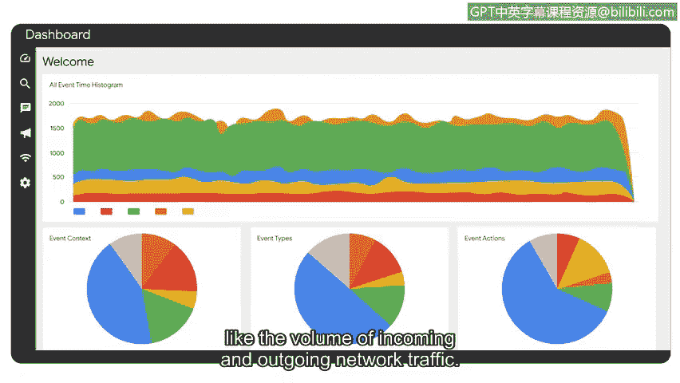

# 谷歌网络安全专业证书第二课：《安全风险管理》（中英字幕，前面分p中字，后面分p英字） - P59：23_03_siem-dashboards.en_subtitled - GPT中英字幕课程资源 - BV1wX4y177AS

We've explored how Sim tools are used to collect and analyze log data。 However。

 this is just one of the many ways Sim tools are used in cybersecur。

 Sim tools can also be used to create dashboards。You might have encountered dashboards in an app on your phone or other device。

 They present information about your account or location in a format that's easy to understand。

 For example， weather apps display data like temperature， precipitation。

 wind speed and the forecast using charts， graphs and other visual elements。

 This format makes it easy to quickly identify weather patterns and trends so you can stay prepared and plan your day accordingly。

Just like weather apps help people make quick and informed decisions based on data。

 Sim dashboards help security analysts quickly and easily access their organizations security information as charts。

 graphs or tables。 For example， a security analyst receives an alert about a suspicious login attempt。

 The analyst accesses their Sim dashboard to gather information about this alert。

 using the dashboard。 The analyst discovers that there have been 500 login attempts for Yura's account in the span of five minutes。

 They also discover that the login attempts happen from geographic locations outside of Yua's usual location and outside of her usual working hours。

 By using the dashboard。 the security analyst was able to quickly review visual representations of the timeline of the login attempts。

 The location and the exact time of。The activity then determined that the activity was suspicious。

In addition to providing a comprehensive summary of security related data。

 SIM dashboards also provide stakeholders with different metrics。

Metrics are key technical attributes such as response time， availability and failure rate。

 which are used to assess the performance of a software application。

SIM dashboards can be customized to display specific metrics or other data that are relevant to different members in an organization。

For example， a security analyst may create a dashboard that displays metrics for monitoring everyday business operations like the volume of incoming and outgoing network traffic。

 We've examined how security analysts use Sim dashboards to help organizations maintain their security posture。

 Well done。

Coming up， we'll discuss some common SIim tools used in the cybersecurity industry， meet you there。

