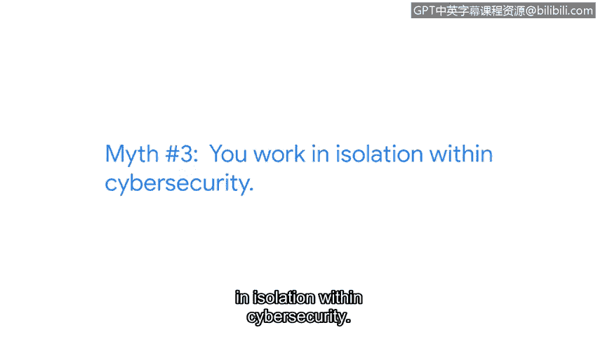

# 谷歌网络安全专业证书第二课：《安全风险管理》（中英字幕，前面分p中字，后面分p英字） - P62：26_03_talya-myths-about-the-cybersecurity-field.en_subtitled - GPT中英字幕课程资源 - BV1wX4y177AS

I'm Talia and I am an engineer within privacy safety and security at Google。

 So there are a lot of myths in the cybersecurity space。

 One big one is you must know how to code or you must know how to hack or you must be a math whiz I don't know how to code。

 although I have learned how to read code over time。 I'm not a hacker。

 I'm I'm not on on on the red team side of security and more like on the blue team。

 I'm not a math whiz。 I definitely took the business route， but I'm not a mathematician。

 that wasn't really the path。 So a lot of my strength really lies in my ability to build relationships learn quickly on the job doing conducting research asking all the right questions。

 I think those have been my strongest strength。 Another big myth is that you are required to have a cybersecurity degree。

 I actually went to school for business in advance。Dereee is not required。

 even though I did later on go back。 That was my preference。

 you do not need to pursue that in order for you to be considered a great candidate for cybersecurity。

 Another big one is you work in isolation within cybersecurity It really depends on the path that you choose but I found it that to be one of the the most couldn't be further from the truth my biggest advice for anyone who's interested in cybersecurity is be okay with creating your own path。

 The path looks different for everyone， if you were to talk to five different people。

 their journeys are all different， so on your journey and you know。

 identify people who can support you let them know that you're sitting for the certificate and see what kind of support that you can get as you start your journey。

