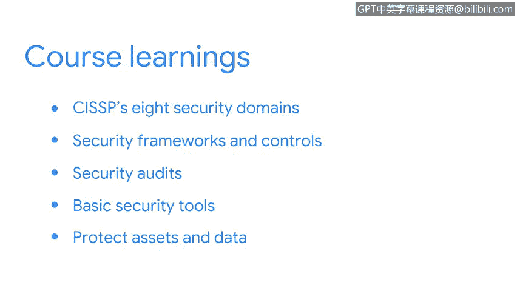

# 谷歌网络安全专业证书第二课：《安全风险管理》（中英字幕，前面分p中字，后面分p英字） - P70：34_01_course-wrap-up.en_subtitled - GPT中英字幕课程资源 - BV1wX4y177AS

Congratulations on completing this course。 Let's recap what we've covered so far。 First。

 we reviewed C I SSP's8 security domains and focused on threats。

 risks and vulnerabilities to business operations。 Then we explored security frameworks and controls and how they're a starting point for creating policies and processes for security management。

😊，This included a discussion of the CIA Triad， NIST frameworks and security design principles。

 and how they benefit the security community as a whole。

This was followed by a discussion about how frameworks。

 controls and principles are related to security audits。

 We also explored basic security tools such as Sim dashboards and how they are used to protect business operations。

And finally， we covered how to protect assets and data by using playbooks。

As a security analyst， you may be working on multiple tasks at once。

 understanding the tools you have at your disposal and how to use them will elevate your knowledge in the field while helping you successfully accomplish your everyday tasks。

 Com up next in the program。 My colleague Chris will provide more details about topics covered in this course and introduce you to some new core security concepts。

 I've enjoyed sharing this journey with you。