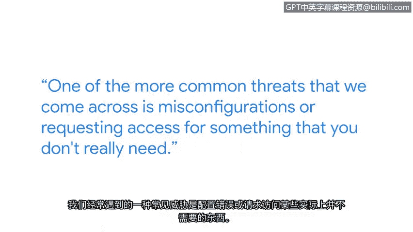

# 谷歌网络安全专业证书第二课：《安全风险管理》（中英字幕，前面分p中字，后面分p英字） - P8：7_赫伯特：管理威胁、风险和漏洞.zh - GPT中英字幕课程资源 - BV1wX4y177AS

。

My names Herbert and I am a security engineer at Google I think I've always been interested in security in high school our school gave us these huge Dell laptops。

 there wasn't a whole lot of security within those computers so many of my friends would have cracked versions of like video games like Halo that's really where I learned how to start manipulating computers to kind of do what I want I guess。

My dayto day consists of analyzing security risks and providing solutions to those risks a typical task for cybersecurity analyst would usually be something like exceptions requests analyzing if someone needs to have special access to a device or document based on the role that the person has or the project that they're working on one of the more common threats that we come across misconfigurations or requesting access for something they don't really need for example。

 I recently had a case where a vendor we were working with had changed their OA scopepe requests and basically that means that they were requesting more permissions to use Google services than they had before in the past we weren't sure really how to go about that because that wasn't a situation we've come across before So it's still ongoing but we're working with partner teams to kind of develop up a solution for that I think another thing that we've seen is outdated systems machines that need to be patched。

That sounds like an IT issue， but it's also definitely a cybersecurity issue。

 having outdated machines， not having proper device management policies。

 working with a team or many teams is a huge part of the job in order to get really anything done you need to communicate with not just the team that you're a part of but with other teams 10 years ago I was working on a pizza joint。

10 years later， here I am at Google as a security engineer。

 if I told my 16 year old self that I would be here， I wouldn't have believed myself。

 but it is possible。

