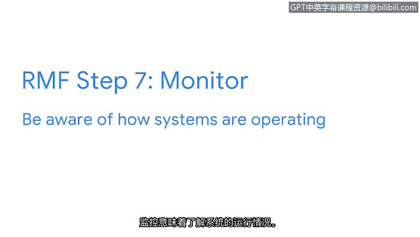

# 谷歌网络安全专业证书第二课：《安全风险管理》（中英字幕，前面分p中字，后面分p英字） - P9：8_NIST的风险管理框架.zh - GPT中英字幕课程资源 - BV1wX4y177AS

As you might remember from earlier in the program， the National Institute of Standards and Technology。

 NIST provides many frameworks that are used by security professionals to manage risks， threats。

 and vulnerabilities。In this video， we're going to focus on NIST's risk management framework or RMF。

As an entry level analyst， you may not engage in all of these steps。

 but it's important to be familiar with this framework。

Having a solid foundational understanding of how to mitigate and manage risks can set yourself apart from other candidates as you begin your job search in the field of security。

 There are  seven steps in the R M， F， prepare。Categorize。Select。Implement。Assess。

Authorize and monitor。Let's start with step one， prepare。

Prepare refers to activities that are necessary to manage security and privacy risks before a breach occurs。

As an entry level analyst， you'll likely use this step to monitor for risks and identify controls that can be used to reduce those risks。

Step 2 is categorize， which is used to develop risk management processes and tasks。

Security professionals then use those processes and develop tasks by thinking about how the confidentiality。

 integrity and availability of systems and information can be impacted by risk。

As an entry level analyst， you'll need to be able to understand how to follow the processes established by your organization to reduce risks to critical assets such as private customer information。

Step three is select。Select means to choose， customize。

 and capture documentation of the controls that protect an organization。

An example of the select step would be keeping a playbook up to date or helping to manage other documentation that allows you and your team to address issues more efficiently。

Step four is to implement security and privacy plans for the organization。

Having good plans in place is essential for minimizing the impact of ongoing security risks。

For example， if you notice a pattern of employees constantly needing password resets。

 implementing a change to password requirements may help solve this issue。 Step 5 is assess。

 A means to determine if established controls are implemented correctly。

An organization always wants to operate as efficiently as possible。

 So it's essential to take the time to analyze whether the implemented protocols。

 procedures and controls that are in place are meeting organizational needs。😡，During this step。

 analysts identified potential weaknesses and determine whether the organization's tools， procedures。

 controls and protocols should be changed to better manage potential risks。Step 6 is authorized。

 Authorize means being accountable for the security and privacy risks that may exist in an organization。

As an analyst， the authorization step could involve generating reports， developing plans of action。

 and establishing project milestones that are aligned to your organization's security goals。

Step7 is monitor。Monitor means to be aware of how systems are operating。

Assessing and maintaining technical operations are tasks that analysts complete daily。

Part of maintaining a low level of risk for an organization is knowing how the current system support the organization's security goals。

If the systems in place don't meet those goals， changes may be needed。

Although it may not be your job to establish these procedures。

 you will need to make sure their working is intended so that risks to the organization itself and the people it serves are minimized。

