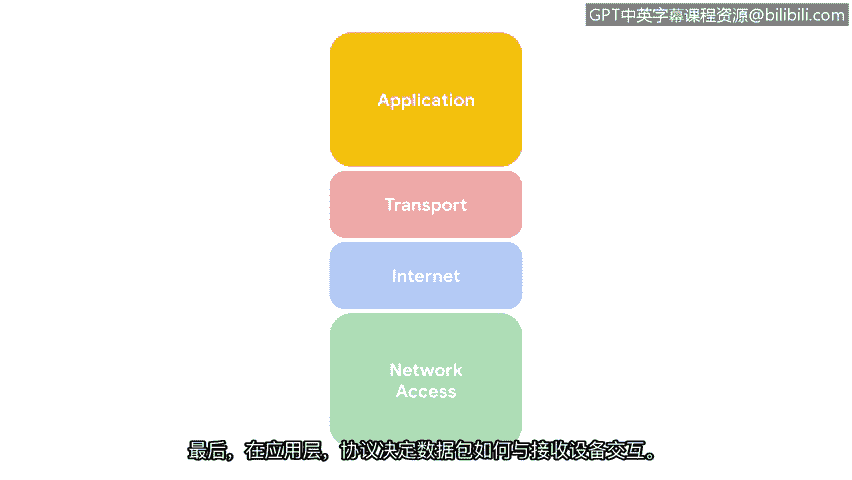

# 谷歌网络安全专业证书第三课：《连接与保护：网络与网络安全》（中英字幕，前面分p中字，后面分p英字） - P11：10_TCP-IP模型的四层.zh - GPT中英字幕课程资源 - BV1Zu4y1y7ht

Now that we' have discussed the structure of a network and how communications takes place。

 it's important for you to know how the security professionals identify problems that might arise。

The TCPIP model is a framework that is used to visualize how data is organized and transmitted across the network。

The TCPIP model has four layers。 The four layers are the network access layer， the Internet layer。

 the transport layer， and the application layer。Knowing how the TCPIP model organizes network activity allows security professionals to monitor and secure against risks。

Let's examine these layers one at a time。Layer 1 is the network access layer。

 The network access layer deals with creation of data packets and their transmission across a network。

 This includes hardware devices connected to physical cables and switches that direct the data to its destination。

Layer 2 is the Internet layer。 The Internet layer is where I P addresses are attached to data packets to indicate the location of the sender and receiver。

 The Internet layer also focuses on how networks connect to each other。 For example。

 data packets containing information that determine whether they will stay on the land or be sent to a remote network like the Internet。

The transport layer includes protocols to control the flow of traffic across a network。

These protocols permit or deny communication with other devices and include information about a status of the connection。

Activities of this layer include error control， which ensures data is flowing smoothly across the network。

Finally， at the application layer， protocols determine how the data packets will interact with receiving devices。

Functions that are organized at application layer include file transfers and email services。

Now you have an understanding of the TCPIP model and its four layers。Meet you in the next video。

