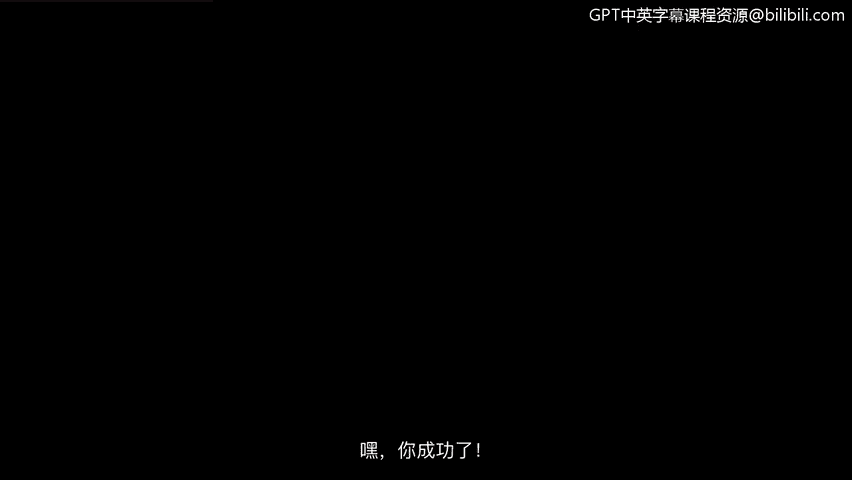
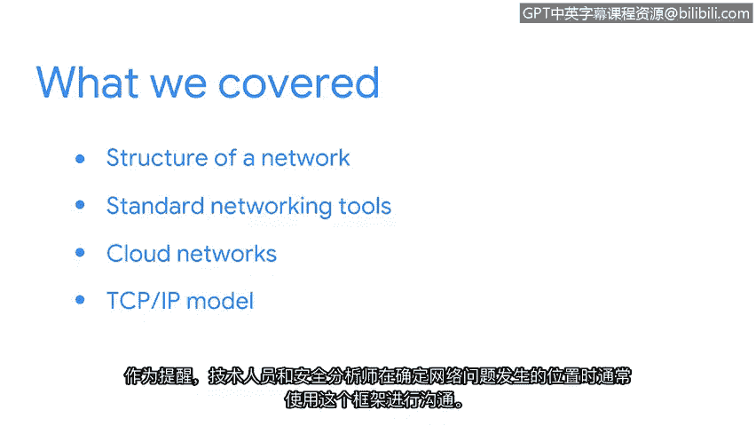

# 谷歌网络安全专业证书第三课：《连接与保护：网络与网络安全》（中英字幕，前面分p中字，后面分p英字） - P13：12_总结.zh - GPT中英字幕课程资源 - BV1Zu4y1y7ht

Hey， you made it well done。Let's wrap up what you've learned in this section of the course。

 We explored the structure of a network， including ws and lands。

 We also discuss standard networking tools like hubs， switches， routers and modems。

 We briefly introduce cloud networks， and we discuss their benefits。

 We also spend some time on the TC P I P model As a reminder。

 technicians and security analysts often use this framework when communicating where network problems have occurred。

That wraps up this section next you'll learn more about network operations and how data is transmitted over wireless networks。

