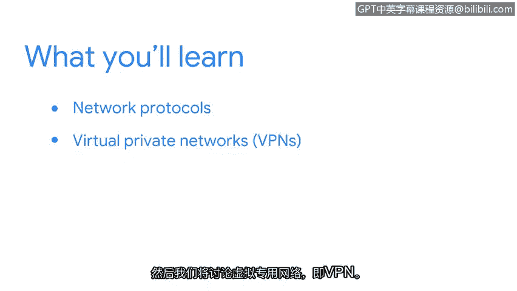

# 谷歌网络安全专业证书第三课：《连接与保护：网络与网络安全》（中英字幕，前面分p中字，后面分p英字） - P14：13_欢迎来到第二周.zh - GPT中英字幕课程资源 - BV1Zu4y1y7ht

Congratulations on the progress you've made so far。In this section。

 you'll learn about how networks operate using tools and protocols。

These are the concepts that you'll use every day in your work as a security analyst。

 the tools and protocols you'll learn in this section of the program will help you protect your organization's network from attack。

Did you know that malicious actors can take advantage of data moving from one device to another on a network？

Thankfully， there are tools and protocols to ensure the network stays protected against this type of threat。

As an example， I once identified an attack based solely on the fact they were using the wrong protocol。

 The network traffic volumes were right， was coming from a trusted I P。

 but it was on the wrong protocol， which tipped us off enough to shut down the attack before they caused real damage。

 First， we'll discuss some common network protocols。

 Then we'll discuss virtual private networks or VPNs。 And finally， we'll learn about firewalls。

 security zones and proxy servers。

Now that you have an idea of where we're headed， let's get started。

