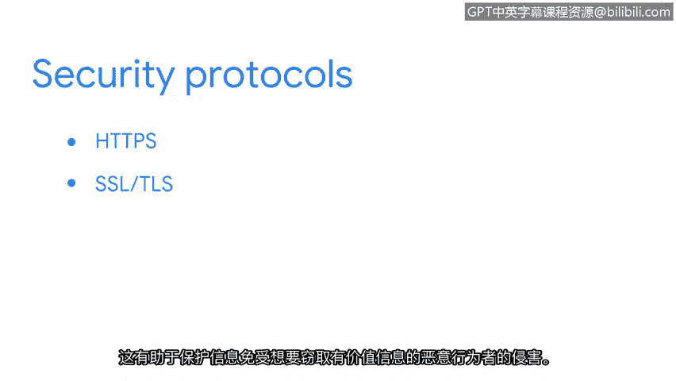

# 谷歌网络安全专业证书第三课：《连接与保护：网络与网络安全》（中英字幕，前面分p中字，后面分p英字） - P15：14_网络协议.zh - GPT中英字幕课程资源 - BV1Zu4y1y7ht

Networks benefit from having rules Rules ensure that data sent over the network gets to the right place。

These rules are known as network protocols。Network protocols are a set of rules used by two or more devices on a network to describe the order of delivery and the structure of the data。

Let's use a scenario to demonstrate a few different types of network protocols and how they work together on a network。

 say you want to access your favorite recipe website。

 You go to the address bar at the top of your browser and type in the website's address。 For example。

 www。yummyrecipesforme org。Before you gain access to the website。

 your device will establish communications with a web server that communication uses a protocol called the transmission control Proto。

 or TCP。TC P is an Internet communications protocol that allows two devices to form a connection and stream data。

 TCP also verifies both devices before allowing any further communications to take place。

 This is often referred to as a handshake。Once communication is established using a TCP handshake。

 a request is made to the network。Using our example。

 we have requested data from the yummy recipe for me server。

 Their servers will respond to that request and send data packets back to your device so that you can view the web page as data packets move across the network。

 they move between network devices， such as routers。The address resolution protocol。

 or ARP is used to determine the Mac address of the next router or device in the path。

This ensures that the data gets the right place。Now the communication's been established and the destination device is known。

 it's time to access the yummy recipe for me website， the Hypertext transferfer protocol， Secure。

 or HtTPS， is a network protocol that provides a secure method of communication between client and website servers。

It allows your web browser to securely send a request for a web page to the yummy recipes for me server and receive a web page as a response。

Next comes a protocol called the domain Name system or DNS。

 which is a network protocol that translates internet domain names into IP addresses。

The DNS protocol sends the domain name in the Web address to a DNS server that retrieves the I address of the website you are trying to access。

 In this case， yummy recipes for me。The IP address is included as a destination address for the data packets traveling to the yummy recipes for me Webserv。

So just by visiting one website， the device on your networks are using four different protocols， TCP。

 ARP， HTPS， and DNS。These are just some of the protocols used in network communications to help you learn more about the different protocols。

 we'll discuss them further in an upcoming course material。

 but how do these protocols relate to security？Well， in the yummy recipes for me website example。

 we used HTTPS， which is a secure protocol that requests a web page from a web server。

HTTPS encryptps data using the secure socket layer and transport layer security。

 otherwise known as SSL TLS。This helps keep the information secure for malicious actors who want to steal valuable information。

 That's a lot of information and a lot of protocols to remember throughout your career as a security analyst。

 you'll become more familiar with network protocols and use them in your daily activities。

