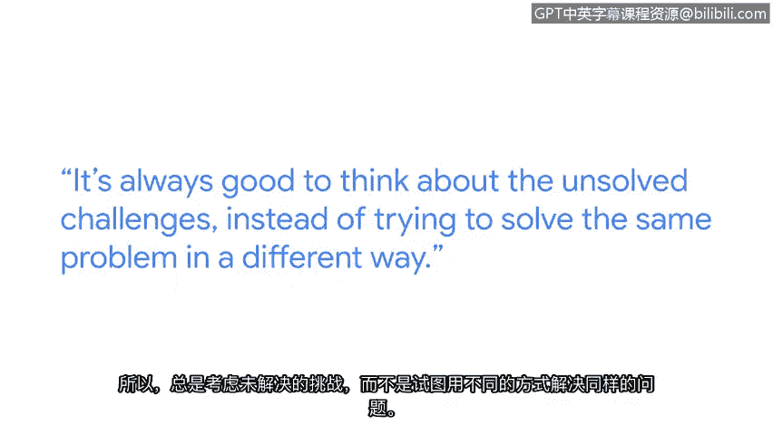

# 谷歌网络安全专业证书第三课：《连接与保护：网络与网络安全》（中英字幕，前面分p中字，后面分p英字） - P16：15_安塔拉：在网络安全领域工作.zh - GPT中英字幕课程资源 - BV1Zu4y1y7ht

My name is Anra， I work on the enterpriseterprise Instructure protectionte team at Google and our main job responsibility is to protect the infrastructure that all the amazing Google products run on。

😊，I didn't start with a background in computers and I did my undergrad in electronics and communication which is far away from computers。

 I took up the challenge to actually pivot into computers with my first job that actually led me to explore the security world even more and that's how I led to doing my masters in security。

 get an expertise in that area and then come to Google as a security engineer。

A typical day in the life of an entry level network security engineer would start with solving a problem。

 Maybe you're trying to debug why is this particular endpoint flooded with so much traffic or why is this endpoint actually slowing down and you would start with okay let me get to the endpoint。

 let me capture some traffic on the endpoint and see what kind of traffic is coming in and going out through this endpoint So I would typically go back think about the problem during launch sometimes things would click when you're thinking you might not have thought about a problem from a different perspective you might want to actually see how it looks like So you would go about maybe doing a library recre。

 let me connect these endpoints and let me try to reproduce the issue you might see some things in the library that you might have not thought of and you might need to actually consultd with experts from different domains who might know better about this area get their view on what the problem is analyze show them everything that you have done you might get your solution just by talking to people。

The idea its also a very， very fun day， it's like solving puzzles all the time。

 which is pretty exciting。😊，Some of the best practices in network security that I've learned are don't try to always reinvent the wheel there are certain protocols。

 there are certain algorithms that have been tried tested。

 analyzed and they have been deemed secure for being used in network security the time that you spend on reinventing the wheel is not going to give you the benefits that you need so it's always good to think about the unsolved challenges instead of trying to solve the same problem in a different way。

I feel cybersecurity is actually a great field to get into right now because as you see we're in this information age where tech is exponentially growing。

 just getting into this field is just going to be exciting because there are amazing new challenges coming up in this field。

😊。