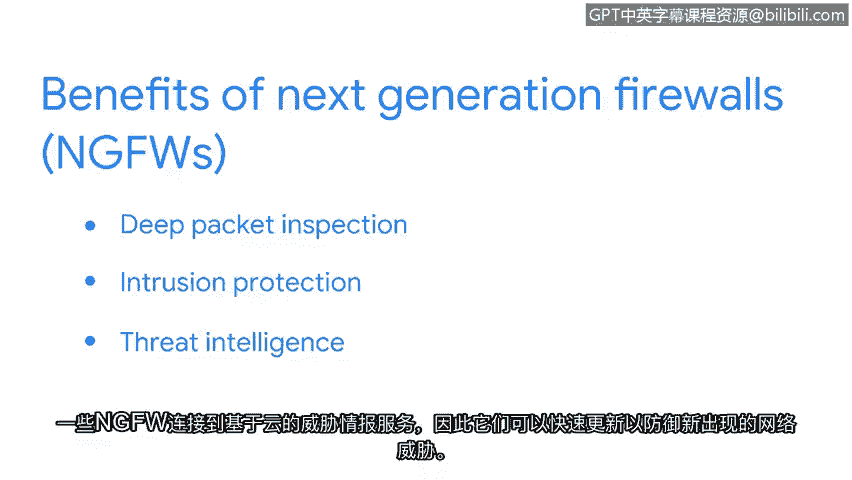

# 谷歌网络安全专业证书第三课：《连接与保护：网络与网络安全》（中英字幕，前面分p中字，后面分p英字） - P18：17_防火墙和网络安全措施.zh - GPT中英字幕课程资源 - BV1Zu4y1y7ht

In this video， you'll learn about different types of firewalls。 These include hardware。

 software and cloud based firewalls。You'll also learn the difference between a stateless and stateful firewall and cover some of the basic operations that a firewall performs。

Finally， you'll explore how proxy servers are used to add a layer of security to the network。

A firewall is a network security device that monitors traffic to and from your network。

 It either allows traffic or it blocks it based on a defined set of security rules。

 A firewall can use port filtering， which blocks or allows certain port numbers to limit unwanted communication。

For example， could have a rule that only allows communications on port 443 for HPS。

 or port 25 for email and blocks everything else。These firewall settings would be determined by the organization's security policy。

Let's talk about a few different kinds of firewalls。

 A hardware firewall is considered the most basic way to defend against threats to a network。

AHar firewall inspects each data packet before it's allowed to enter the network。

A software firewall performs the same functions as a hardware firewall。

 but it's not a physical device。 Instead， it's a software program installed on a computer or on a server。

If the software firewall is installed on a computer。

 it will analyze all the traffic received by that computer。

If the software firewall is installed on a server， it will protect all the devices connected to the server。

A software firewall typically costs less than purchasing a separate physical device。

 and it doesn't take up any extra space。But because it is a software program。

 it will add some processing burden to the individual devices。

Organizations may choose to use a cloud based firewall。

 Cloud service providers offer firewalls as a service or FAAAS for organizations。

Cloud based firewalls are software firewalls hosted by a cloud service provider。

Organizations can configure the firewall rules on the cloud service providers' interface。

 and the firewall will perform security operations on all incoming traffic before it reaches the organization's onsite network。

Cloud based firewalls also protect any assets or processes that an organization might be using in the cloud。

 All the firewall we have discussed can be either stateful or stateless。

 The terms stateful and stateless refer to how the firewall operates。

Stateful refers to a class of firewall that keeps track of information passing through it and proactively filters out threats。

A stateful firewall analyzes network traffic for characteristics and behavior that appears suspicious and stops them from entering the network。

 State less refers to a class of firewall that operates based on predefined rules and does not keep track of information from data packets。

 A stateless firewall only acts according to precongured rules set by the firewall administrator。

The rules programmed by the firewall administrator tell the device what to accept and what to reject。

A stateless firewall doesn't store analyze information。

 It also doesn't discover suspicious trends like a stateful firewall does。 For this reason。

 stateless firewalls are considered less secure than stateful firewalls。

 A next generation firewall or N GFW provides even more security than a stateful firewall。

 Not only does an N GFW provides stateful inspection of incoming and outgoing traffic。

 but it also performs more in depth security functions like deep packet inspection and intrusion protection。

 Some N GF Ws connect to cloud based threat intelligence services so they can quickly update to protect against emerging cyber threats。

Now you have a basic understanding of firewalls and how they work。

We learn that firewalls can be hardware or software。

 we also discussed the difference between a stateless and stateful firewall and the security benefits of a stateful firewall。

Finally， we discuss next generation firewalls and the security benefits they provide。Coming up。

 we'll learn more about virtual networks。

