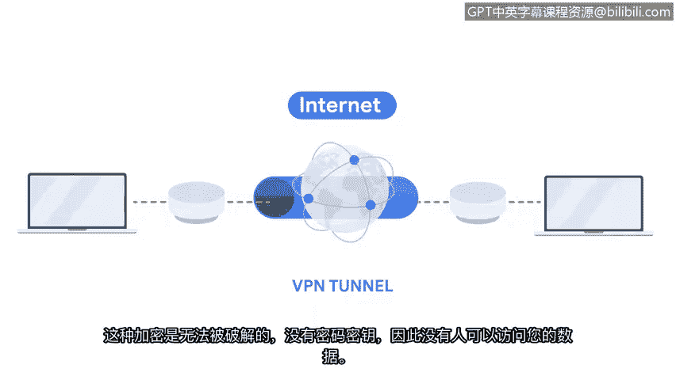

# 谷歌网络安全专业证书第三课：《连接与保护：网络与网络安全》（中英字幕，前面分p中字，后面分p英字） - P19：18_虚拟私有网络（VPN）.zh - GPT中英字幕课程资源 - BV1Zu4y1y7ht

In this video， we're going to discuss how virtual private networks or VPNs add security to your network。

When you connect to the Internet， your Internet service provider receives your network's request and forwards it to the correct destination server。

 but your internet requests include your private information。

 That means if the traffic gets intercepted， someone could potentially connect your internet activity with your physical location and your personal information。

This includes some information that you want to keep private。

 like bank accounts and credit card numbers。A virtual private network also known as a VPN。

 is a network security service that changes your public I address and hides your virtual location so that you can keep your data private when you're using a public network like the Internet。

 VPNs also encrypt your data as it travels across the Internet to preserve confidentiality。

A VPN service performs encapsulation on your data in transit。

capsulation is a process performed by a VPN service that protects your data by wrapping sensitive data in other data packets。

Previously， you learned how the Mac and I P address of the destination device is contained in the header and footer of a data packet。

 This is a security thread because it shows the I P and virtual location of your private network。

You could secure a data packet by encrypting it to make sure your information can't be deciphered。

 but then network routers won't be able to read the IP and Mac address to know where to send it to。

This means you won't be able to connect to the Internet site or the service that you want。

Encapsulation solves this problem while still maintaining your privacy。

VPN services encrypt your data packets and encapsulate them in other data packets that the routers can read。

 This allows your network requests to reach their destination， but still encrypts your personal data。

 So it's unreadable while in transit。A VPN also uses an encrypted tunnel between your device and the VPN server。

 The encryption is unhackable without a cryptographic key， so no one can access your data。

 VPN services are simple and offer significant protection while youre on the Internet with a VPN。

 you have the added assurance that your data is encrypted。

 Your I P address and virtual location are unreadable to malicious actors。

