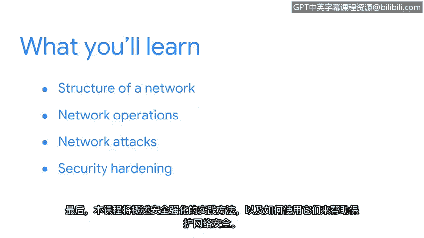

# 谷歌网络安全专业证书第三课：《连接与保护：网络与网络安全》（中英字幕，前面分p中字，后面分p英字） - P1：0_课程介绍 3.zh - GPT中英字幕课程资源 - BV1Zu4y1y7ht

You've learned about security domains in previous courses。

 Now we will explore one of those domains further， networks。

It's important to secure networks because network based attacks are growing in both frequency and complexity。

Hi there。 My name is Chris and I'm the chief information security officer for Google Fber。

 I'm excited to be your instructor for this course。

 I've been working in network security and engineering for over 20 years and I'm looking forward to sharing some of my knowledge and experience with you。

This course will help you understand the basic structure of a network also referred to as a network architecture and commonly use network tools。

 you'll also learn about network operations and explore some basic network protocols。Next。

 you'll learn about common network attacks and how network intrusion tactics can prevent a threat to a network。

Finally， the course will provide an overview of security hardening practices and how you might use them to help secure a network。

 There's a lot to learn in securing networks。 and I'm excited to go on this journey with you ready to get started。

 Let's go。😊。

