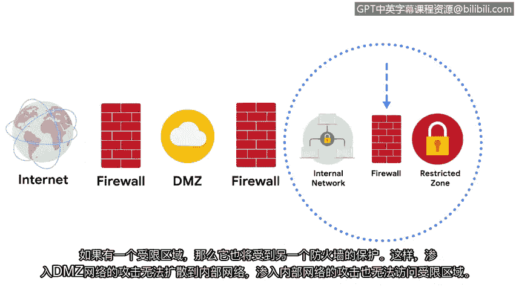

# 谷歌网络安全专业证书第三课：《连接与保护：网络与网络安全》（中英字幕，前面分p中字，后面分p英字） - P20：19_安全区域.zh - GPT中英字幕课程资源 - BV1Zu4y1y7ht

In this section， we'll discuss a type of network security feature called a security zone。

Security zones are a segment of a network that protects the internal network from the internet。

They are part of the security technique called network segmentation。Ds the network into segments。

 Each network segment has its own access permissions and security rules。

Security zones control who can access different segments of a network。

 Security zones act as a barrier to internal networks。

 maintain privacy within corporate groups and prevent issues from spreading to the whole network。

One example of network segmentation is a hotel that offers free public Wi Fi。

The unsecured guest network is kept separate from another encrypted network used by the hotel staff。

Additionally， an organization's network can be divided into subnet or subnets to maintain privacy for each department and an organization。

 For instance， at a university， there may be a faculty subnet and a separate student subnet。

If there is contamination on the student subnet， network administrators can isolate it and keep the rest of the network free from contamination。

An organization's network is classified into two types of security zones。 First。

 there is the uncontrolled zone， which is any network outside the organization's control like the Internet。

Then there's the controlled zone， which is a subnet that protects the internal network from the uncontrolled zone。

There are several types of network within the controlled zone on the outer layer is the demilitarized zone or DMZ。

 which contains public facing services that can access the internet。This includes web servers。

 proxy servers that host websites for the public and DNS servers that provide IP addresses for Internet users。

 It also includes email and file servers that handle external communications。

The DMZ acts as a network perimeter to the internal network。

The internal network contains private servers and data that the organization needs to protect。

Inside the internal network is another zone called the restricted zone。

The restricted zone protects highly confidential information that is only accessible to employees with certain privileges。

Now， let's try to picture these security zones。 Idely， the DMMZ is situated between two firewalls。

 One of them filters traffic outside the DMMZ， and one of them filters traffic entering the internal network。

This protects the internal network with several lines of defense。 If there' is a restricted zone。

 that， too， would be protected with another firewall。 This way。

 attacks that penetrate into the DMMZ network cannot spread to the internal network and attacks that penetrate the internal network cannot access the restricted zone。

As a security analyst， you may be responsible for regulating access control policies on these firewalls。

 Security teams can control traffic reaching the DMZ and the internal network by restricting I Ps and ports。

For example， an analyst may ensure that only H ETPS traffic is allowed to access web servers in the DMZ。

 Security zones are an important part of securing networks， especially at large organizations。

Understanding how they are used is essential for all security analysts coming up will learn about securing internal networks。

