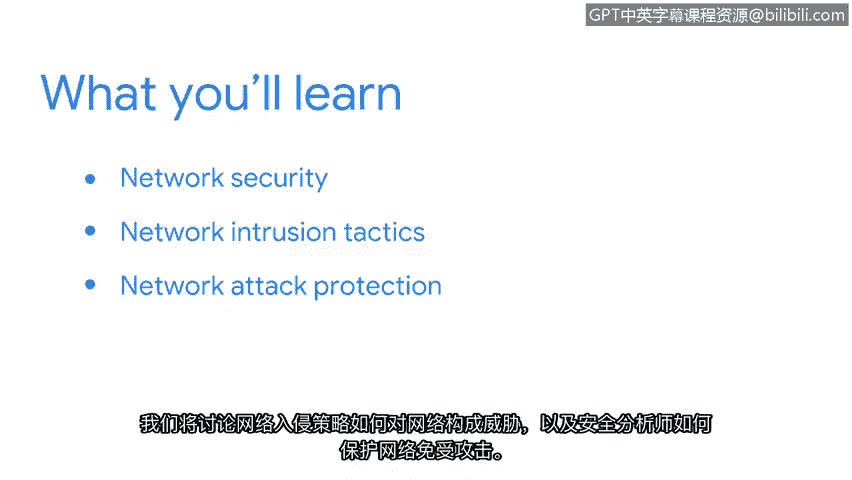

# 谷歌网络安全专业证书第三课：《连接与保护：网络与网络安全》（中英字幕，前面分p中字，后面分p英字） - P23：22_欢迎来到第三周.zh - GPT中英字幕课程资源 - BV1Zu4y1y7ht

Hey there。 Welcome to this video about securing networks from attacks。

 You've come a long way already in your understanding of networks and network security。 Now。

 you'll learn how to secure networks so that the valuable information they contain doesn't get into the wrong hands。

 We're going to discuss how network intrusion tactics can present a threat to networks and how a security analyst can protect against network attacks。

 Let's get started。😊。

